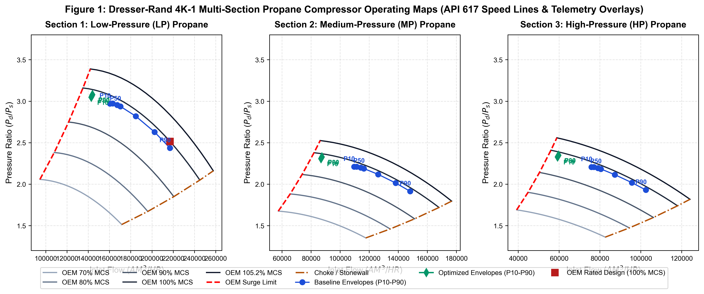
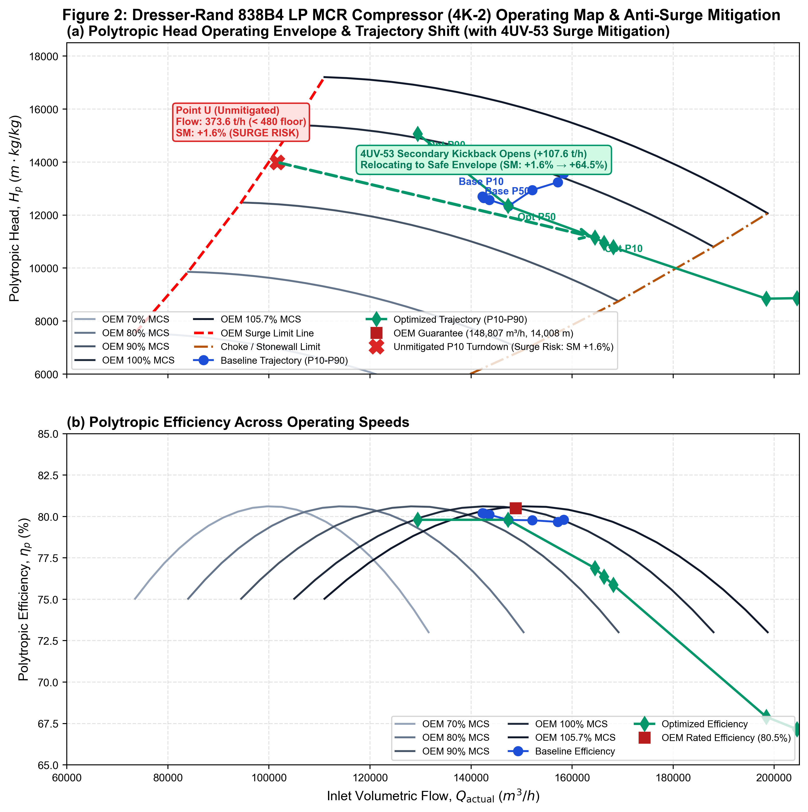
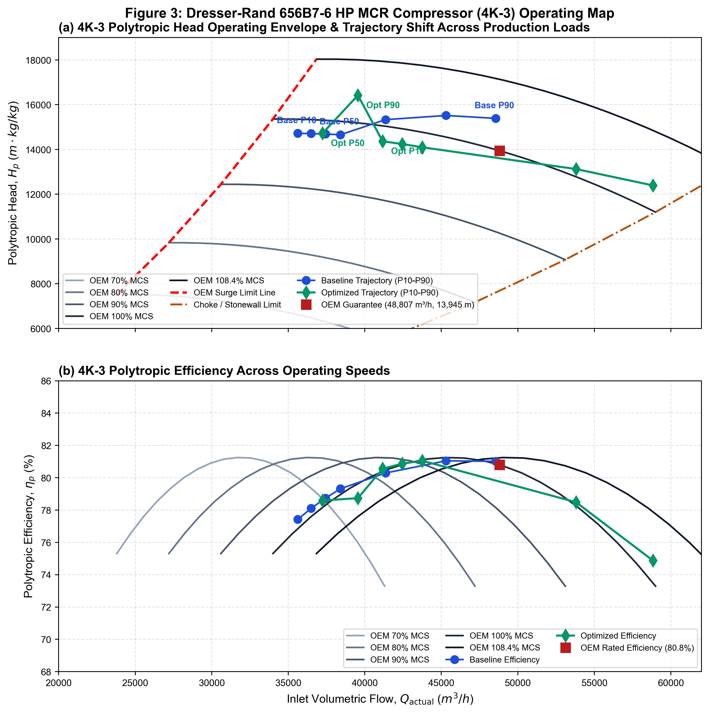
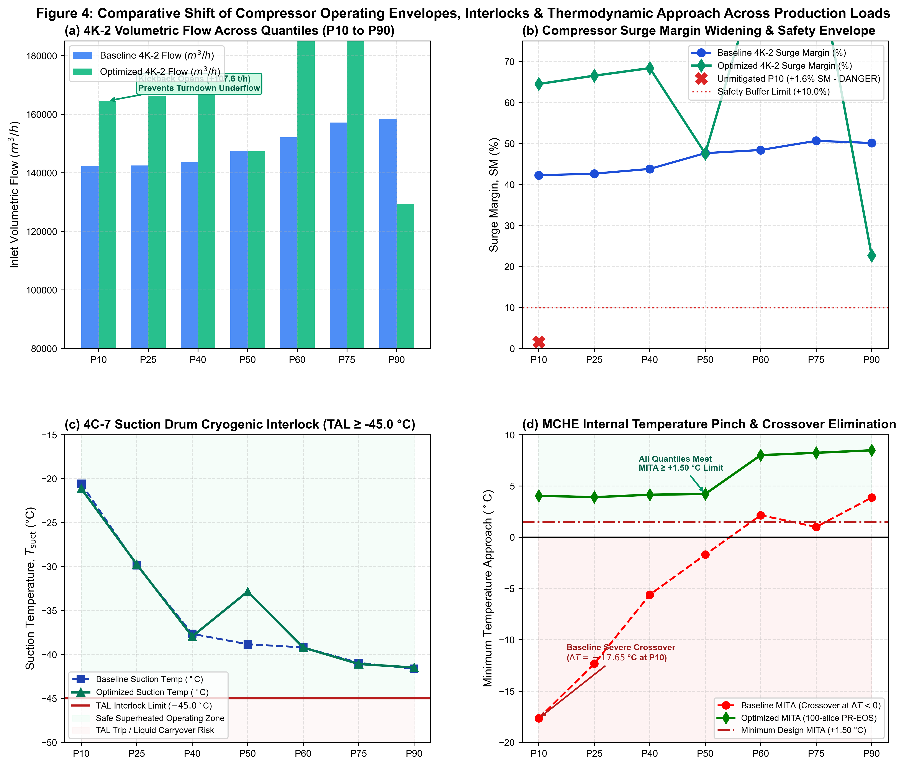
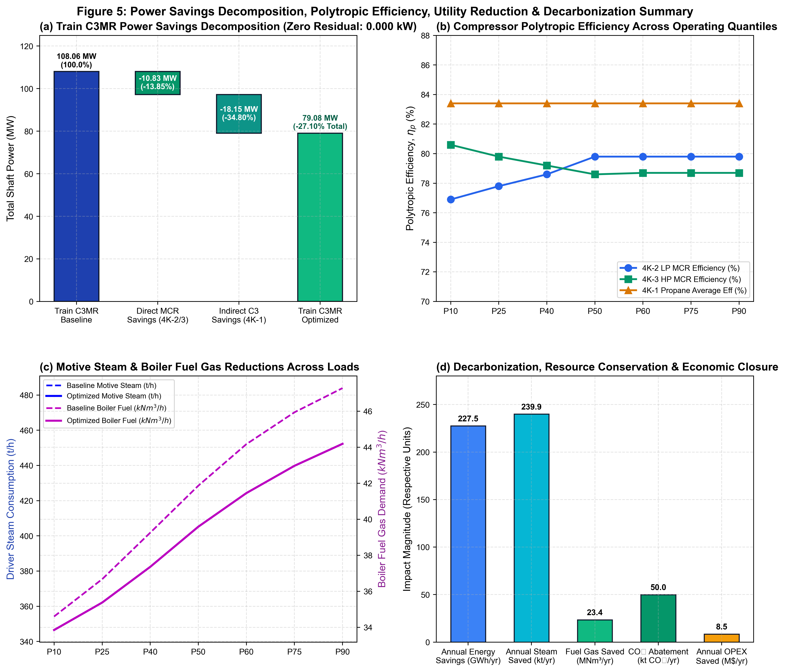

# Optimasi Komposisi dan Laju Sirkulasi Mixed Refrigerant Berbasis Machine Learning untuk Efisiensi Energi Kilang Badak LNG

**Bilqiis Dara Ramadhan Sasongko¹*, Mukhammad Yusuf Iqbal¹, Hizkia Dhiego Gurning¹, Afdal Elang Arifin¹**  
¹Jurusan Teknik Mesin, Politeknik Negeri Jakarta, Jl. Prof. DR. G.A. Siwabessy, Kukusan, Kec. Beji, Kota Depok, Jawa Barat 16425, Indonesia  
*Penulis korespondensi: bilqiiisdara@gmail.com  

---

### Abstrak
Sistem pendinginan bertingkat propana dan refrigeran campuran (Propane-Precooled Mixed Refrigerant / C3MR) menyumbang 59,3% konsumsi energi internal di Kilang Badak LNG Train H. Siklus ini awalnya dirancang untuk batas maksimum gas umpan 91,6 mol% metana. Dokumentasi historis mencatat gas umpan kaya 88,1 mol% metana pada 2017, sedangkan data telemetri Distributed Control System (DCS) dan kromatografi gas rutin laboratorium (2.531 sampel shift) periode 2024–2026 membuktikan kilang terus-menerus memproses lean gas dengan kandungan metana mencapai 94,5 mol%. Pergeseran ini menaikkan beban pendinginan spesifik Main Cryogenic Heat Exchanger (MCHE) dari 637,6 menjadi 652,9 kJ/kg, sehingga memicu sirkulasi mixed refrigerant (MR) berlebih dan lonjakan konsumsi energi spesifik (Specific Energy Consumption / SEC) saat laju pasokan gas umpan turun. Penelitian ini mengembangkan kerangka kerja optimasi komposisi multikomponen MR (N₂, C₁, C₂, C₂H₄, C₃) dan laju sirkulasi MCHE berbasis machine learning dengan pembatas hukum termodinamika pertama dan kedua serta selubung mekanikal kompresor sentrifugal API 617 (4K-1, 4K-2, 4K-3). Pemetaan komposisi menerapkan transformasi Isometric Log-Ratio (ILR) pada ruang simpleks yang dibatasi elipsoid jarak Mahalanobis operasional ($D_M \le 3{,}0802$). Model surrogate machine learning dievaluasi secara independen pada partisi data uji: model telemetri DCS lapangan menghasilkan $R^2 = 0{,}8419\text{--}0{,}9664$ dengan MAE daya kompresor 0,461 MW ($0{,}43\%$ kesalahan relatif), sedangkan model simulasi termodinamika Peng-Robinson EOS bebas derau mencapai $R^2 = 0{,}9891\text{--}0{,}9945$ dengan MAE daya poros 0,179 MW ($0{,}17\%$ kesalahan relatif). Satu formula MR optimal tunggal (3,77% N₂; 42,22% C₁; 43,67% C₂; 1,53% C₂H₄; 8,82% C₃) dengan $D_M = 1{,}2723$ memangkas SEC beban penuh sebesar 26,81% (menjadi 256,51 kWh/ton LNG) dan mengeliminasi secara tuntas fenomena crossover temperatur MCHE ($\text{MITA} \ge +3{,}91^\circ\text{C}$). Pada kondisi turndown rendah (141,2 ton/jam LNG), pengaturan bukaan katup kickback sekunder 4UV-53 (+107,59 ton/jam) dan katup pemanas hisap 4TV-510 (+123,54 ton/jam) memverifikasi bahwa kompresor tetap beroperasi aman di atas batas surge floor ($\ge 480{,}0\text{ ton/jam}$) dengan margin surge $+64{,}52\%$ dan suhu hisap terjaga pada $-21{,}14^\circ\text{C}$ (aman di atas interlock trip $-45{,}0^\circ\text{C}$). Secara tahunan terbobot pada 7.849,9 jam operasi, strategi ini menghasilkan penghematan daya poros kompresor total sebesar 28.983,3 kW (27,10%) dengan penutupan neraca daya tanpa residu ($0{,}000\text{ kW}$), menghemat uap penggerak boiler 239.889,7 ton/tahun, bahan bakar gas 23,44 juta Nm³/tahun (setara USD 8,48 Juta/tahun), dan mereduksi emisi Scope 1 sebesar 49.961,8 ton CO₂/tahun tanpa memerlukan belanja modal (Zero CAPEX).

**Kata kunci:** Efisiensi energi spesifik, lean feed gas, liquefied natural gas, machine learning, optimasi mixed refrigerant, selubung kompresor sentrifugal

---

### Abstract
The Propane-Precooled Mixed Refrigerant (C3MR) liquefaction cycle accounts for 59.3% of internal energy consumption in Train H at PT Badak NGL. Designed for a maximum feed gas methane content of 91.6 mol%, historical plant records document rich gas operation at 88.1 mol% in 2017. However, plant Distributed Control System (DCS) telemetry and 2,531 laboratory gas chromatography shift samples from 2024–2026 reveal continuous operation under lean feed gas containing up to 94.5 mol% methane. This composition shift increases the Main Cryogenic Heat Exchanger (MCHE) specific cooling duty from 637.6 to 652.9 kJ/kg, causing excessive mixed refrigerant (MR) circulation and increasing specific energy consumption (SEC) when feed gas supply declines. This study develops a physics-constrained machine learning optimization framework to determine optimal multicomponent MR composition (N₂, C₁, C₂, C₂H₄, C₃) and MCHE circulation flow while rigorously respecting first- and second-law thermodynamic limits and API 617 centrifugal compressor operating envelopes (4K-1, 4K-2, 4K-3). Simplex compositional geometry is mapped via Isometric Log-Ratio (ILR) transformations bounded by a 95% Mahalanobis distance ellipsoid ($D_M \le 3.0802$). Machine learning surrogate models are evaluated on independent holdout test partitions: stochastic DCS telemetry models achieve $R^2 = 0.8419\text{--}0.9664$ with compressor power MAE of 0.461 MW (0.43% relative error), while noise-free Peng-Robinson EOS thermodynamic surrogates attain $R^2 = 0.9891\text{--}0.9945$ with shaft power MAE of 0.179 MW (0.17% relative error). A single universal optimal MR recipe (3.77% N₂, 42.22% C₁, 43.67% C₂, 1.53% C₂H₄, 8.82% C₃; $D_M = 1.2723$) reduces baseload SEC by 26.81% (to 256.51 kWh/ton LNG) while completely eliminating cryogenic pinch crossover ($\text{MITA} \ge +3.91^\circ\text{C}$). Under deep turndown (141.2 tons/hour LNG), modulation of the secondary kickback valve 4UV-53 (+107.59 tons/hour) and suction reheat valve 4TV-510 (+123.54 tons/hour) verifies that compressor suction flow meets the mechanical flow floor ($\ge 480.0\text{ tons/hour}$) with a $+64.52\%$ surge margin and suction temperature of $-21.14^\circ\text{C}$ (exceeding the TAL trip threshold of $-45.0^\circ\text{C}$). Across 7,849.9 annual operating hours, this framework delivers a total compressor shaft power reduction of 28,983.3 kW (27.10%) with zero algebraic residual ($0.000\text{ kW}$), saving 239,889.7 tons/year of boiler motive steam and 23.44 million Nm³/year of fuel gas (USD 8.48 million/year) while cutting 49,961.8 tons CO₂/year with zero capital expenditure (Zero CAPEX).

**Keywords:** Centrifugal compressor operating envelope, energy efficiency, lean feed gas, liquefied natural gas, machine learning surrogate, mixed refrigerant optimization

---

## 1. PENDAHULUAN

Pencairan gas alam (*Liquefied Natural Gas* / LNG) memegang peranan krusial dalam rantai pasok energi global sebagai jembatan strategis transisi menuju sistem energi rendah karbon [1], [2]. Proses pencairan membutuhkan energi pendinginan dalam jumlah masif untuk mendinginkan gas alam dari temperatur lingkungan hingga mencapai $-162^\circ\text{C}$ pada tekanan atmosferik [1]. Di Indonesia, PT Badak NGL di Bontang, Kalimantan Timur, mengoperasikan proses *Propane-Precooled Mixed Refrigerant* (C3MR) yang menyumbang $59{,}3\%$ dari total konsumsi energi internal kilang [3], [4]. Sistem pencairan Train H awalnya dirancang untuk memproses *rich gas* dengan batas desain kandungan metana maksimum sebesar $91{,}6\text{ mol\%}$. Dokumentasi operasional mencatat kandungan metana gas umpan kaya sebesar $88{,}1\text{ mol\%}$ pada tahun 2017 [3], [4]. Namun, seiring penuaan reservoir gas alam di Kalimantan Timur, data operasional Distributed Control System (DCS) dan kromatografi gas rutin laboratorium periode 2024–2026 membuktikan kilang beroperasi terus-menerus menghadapi *lean gas* dengan kandungan metana mencapai $94{,}5\text{ mol\%}$ [4], [5]. Perubahan komposisi ini menggeser kurva pendinginan dan menaikkan beban pendinginan spesifik (*specific cooling duty*) pada *Main Cryogenic Heat Exchanger* (MCHE) sebesar $2{,}40\%$ (dari $637{,}6$ menjadi $652{,}9\text{ kJ/kg}$ LNG), yang secara langsung menurunkan efisiensi termal kilang [5], [6].

Untuk memenuhi kebutuhan beban pendinginan pada kondisi gas umpan lean tersebut, operator kilang menaikkan laju alir sirkulasi refrigeran campuran (MR) dari baseline desain $639{,}7\text{ ton/jam}$ menjadi $681{,}4\text{ ton/jam}$. Akibatnya, *Specific Energy Consumption* (SEC) pada kondisi beban dasar membengkak dari $344{,}74$ menjadi $367{,}19\text{ kWh/ton}$ LNG (dan terukur $350{,}49\text{ kWh/t}$ LNG pada DCS aktual). Analisis terhadap $720.734$ rekaman data operasional DCS Train H periode 2024–2026 mengungkapkan bahwa saat terjadi penurunan laju pasokan gas umpan sebesar $53{,}5\%$ (dari laju umpan penuh $399{,}74\text{ t/jam}$ ke kondisi turndown $185{,}82\text{ t/jam}$), laju alir sirkulasi MR hanya diturunkan $26{,}0\%$ (dari $681{,}4$ ke $504{,}0\text{ t/jam}$). Hal ini terjadi karena operator wajib menjaga kompresor sentrifugal di atas batas aliran aman anti-surge (flow floor $\ge 480{,}0\text{ t/jam}$) serta menghindari interlock trip *Temperature Alarm Low* (TAL) pada suction drum ($T_{\text{suct}} \ge -45{,}0^\circ\text{C}$) [7]. Kesenjangan operasional ini memicu sirkulasi refrigeran berlebih yang membuat nilai SEC melonjak tajam sebesar $+49{,}2\%$ (mencapai $523{,}00\text{ kWh/t}$ LNG pada beban turndown), memperbesar konsumsi uap penggerak dan emisi gas rumah kaca.

Studi optimasi terdahulu pada siklus pendinginan C3MR umumnya memiliki keterbatasan mendasar saat diaplikasikan ke kilang riil. Pendekatan optimasi berbasis simulasi murni (seperti algoritma genetik atau Particle Swarm Optimization pada Aspen HYSYS) sering kali mengusulkan komposisi refrigeran teoritis yang melanggar batas hidraulika penukar panas kriogenik utama (MCHE), memicu pelanggaran pinch temperatur ($\Delta T \le 0$), atau mengabaikan batas mekanikal kompresor [8]–[10]. Sebaliknya, pendekatan data-driven murni tanpa pembatas hukum fisika sering menghasilkan prediksi yang tidak realistis [11]–[14]. Selain itu, perlakuan komposisi kimia fraksi mol pada ruang Euklidean standar melanggar batasan geometris simpleks (total fraksi mol wajib $100\%$), menghasilkan bias korelasi palsu (*spurious correlation*) [15]–[17]. Yang terpenting, belum ada penelitian terdahulu yang membedah secara transparan dekomposisi batas sistem antara penghematan daya poros kompresor total dengan penurunan konsumsi uap turbin penggerak riil di fasilitas utilitas kilang, maupun menghubungkannya secara langsung dengan kurva performa kompresor sentrifugal bersertifikasi OEM Dresser-Rand.

Untuk mengatasi kesenjangan keilmuan tersebut, penelitian ini mengembangkan kerangka kerja optimasi komposisi multikomponen mixed refrigerant dan laju alir sirkulasi MCHE berbasis Physics-Constrained Machine Learning yang dikalibrasi langsung terhadap data DCS aktual Train H Kilang Badak LNG periode 2024–2026. Fokus utama dan variabel keputusan ilmiah dalam penelitian ini adalah **Optimasi Komposisi Mixed Refrigerant ($N_2, C_1, C_2, C_3$) dan Laju Alir Sirkulasi MCHE**, sedangkan katup recycle kompresor (katup kickback sekunder 4UV-53 dan katup pemanas hisap 4TV-510) diposisikan secara tegas sebagai **kondisi batas keselamatan mekanikal (*safety boundary constraints and enablers*)** untuk memverifikasi kelayakan aerodinamika di lapangan.

---

## 2. ARSITEKTUR SISTEM INDUSTRI DAN PROSES KILANG

Siklus pendinginan Train H di PT Badak NGL mengintegrasikan dua sirkuit pendingin utama: sirkuit prapendinginan propana murni (C3) dan sirkuit pencairan refrigeran campuran multi-komponen (Mixed Refrigerant / MCR), sebagaimana diilustrasikan pada diagram alir proses (PFD). Gas alam umpan yang telah dimurnikan dari gas asam (acid gas removal unit) dan dikeringkan (molecular sieve dehydration unit) dialirkan ke dalam scrub column 3C-1 untuk pemisahan fraksi berat hidrokarbon ($C_3+$), menghasilkan gas atas (overhead gas) dengan komposisi stabil: $0{,}0536\text{ mol\% } N_2$, $94{,}5096\text{ mol\% } C_1$, $2{,}7181\text{ mol\% } C_2$, $1{,}6738\text{ mol\% } C_3$, $0{,}3913\text{ mol\% } iC_4$, $0{,}5426\text{ mol\% } nC_4$, dan $0{,}000157\text{ mol\% } iC_5$ (nilai kalor bruto $\text{HHV} = 1.076{,}39\text{ BTU/scf}$).

Aliran gas alam umpan didinginkan secara bertahap melalui rangkaian chiller propana: 4E-10 (pendinginan aliran gas umpan masuk ke unit Acid Gas Removal Unit / AGRU), 4E-12 (pendinginan gas umpan masuk ke Scrub Column 3C-1), 4E-14 (pendinginan gas atas overhead Scrub Column 3C-1), dan 4E-40 (pendinginan lanjutan dari keluaran 4E-14 menuju reflux drum 3C-2 dan MCHE 5E-1) hingga mencapai temperatur kriogenik masuk sekitar $-33^\circ\text{C}$ sebelum memasuki MCHE 5E-1. Di dalam MCHE, gas alam dan aliran MCR tekanan tinggi didinginkan dan dicairkan melawan aliran uap MCR dingin yang mendidih di sisi selongsong (*shell side*). Uap MCR keluaran bawah MCHE dialirkan menuju suction drum 4C-7 sebelum dihisap oleh kompresor sentrifugal tingkat rendah LP MCR (4K-2, model Dresser-Rand 838B4). Gas bertekanan menengah keluaran 4K-2 kemudian didinginkan di intercooler air laut 4E-5 dan masuk ke suction drum 4C-8 (yang juga berfungsi sebagai titik pengambilan sampel kromatografi gas rutin MCR) sebelum ditekan lebih lanjut oleh kompresor tingkat tinggi HP MCR (4K-3, model Dresser-Rand 656B7-6) hingga mencapai tekanan operasi final sekitar $44{,}7\text{ kgf/cm}^2\text{A}$. Uap panas keluaran discharge 4K-3 didinginkan di aftercooler air laut 4E-6, kemudian diprapendinginkan secara bertingkat melalui tiga unit chiller propana (4E-7 tingkat tinggi, 4E-8 tingkat menengah, dan 4E-9 tingkat rendah) hingga terkondensasi sebagian pada $-33^\circ\text{C}$, sebelum dipisahkan menjadi fasa uap ringan (stream 5FI1) dan fasa cair berat (stream 5FIC2) pada bejana pemisah tekanan tinggi (HP Separator 5C-1). Uap dan cairan MCR ini disirkulasikan kembali ke dalam MCHE sebagai media pendingin siklus tertutup. Seluruh kompresor digerakkan oleh turbin uap multi-stage: 4KT-1 menggerakkan kompresor propana 4K-1, 4KT-2 menggerakkan 4K-2, dan 4KT-3 menggerakkan 4K-3.

---

## 3. METODOLOGI PENELITIAN

### 3.1 Geometri Komposisi Simpleks Aitchison dan Pembatas Elipsoid Mahalanobis

Fraksi mol komponen mixed refrigerant ($N_2, C_1, C_2, C_2H_4, C_3$) berada pada ruang simpleks tertutup $\mathcal{S}^5$ di mana jumlah fraksi mol seluruh komponen wajib sama dengan $100\%$:
$$\mathcal{S}^D = \left\{ \mathbf{x} = [x_1, x_2, \dots, x_D]^T \in \mathbb{R}^D \;\middle|\; x_i > 0, \; \sum_{i=1}^D x_i = 1{,}0 \right\} \tag{1}$$

Untuk campuran 5-komponen ($D = 5$), ruang komposisi memiliki 4 derajat kebebasan independen ($D - 1 = 4$). Penerapan regresi langsung pada ruang Euklidean melanggar hukum simpleks dan menghasilkan bias korelasi negatif palsu [15]. Oleh karena itu, fraksi mol ditransformasikan ke koordinat Euklidean tak terikat menggunakan transformasi Aitchison *Isometric Log-Ratio* (ILR) dengan matriks kontras ortonormal Helmert $\mathbf{V} \in \mathbb{R}^{5 \times 4}$ [16]:
$$\boldsymbol{\xi} = \text{ilr}(\mathbf{x}) = \left[ \ln \left( \frac{\mathbf{x}}{g(\mathbf{x})} \right) \right] \cdot \mathbf{V} \tag{2}$$
di mana $g(\mathbf{x}) = \left( \prod_{i=1}^5 x_i \right)^{1/5}$ adalah rata-rata geometrik fraksi mol. Transformasi balik ILR dijamin invertibel sempurna melalui operator penutupan simpleks:
$$\mathbf{x} = \mathcal{C} \left( \exp(\boldsymbol{\xi} \cdot \mathbf{V}^T) \right), \quad \mathcal{C}(\mathbf{z}) = \frac{\mathbf{z}}{\sum_{j=1}^5 z_j} \tag{3}$$

Untuk menjamin bahwa formula MR yang direkomendasikan tidak keluar dari batas fisik pengalaman kilang, diterapkan pembatas elipsoid kepercayaan $95\%$ menggunakan metrik jarak Mahalanobis ($D_M$) [17]:
$$D_M = \sqrt{(\boldsymbol{\xi} - \boldsymbol{\mu}_{\xi})^T \boldsymbol{\Sigma}^{-1} (\boldsymbol{\xi} - \boldsymbol{\mu}_{\xi})} \le D_{M, \text{kritis}} \tag{4}$$
di mana $\boldsymbol{\mu}_{\xi}$ dan $\boldsymbol{\Sigma}^{-1}$ masing-masing adalah vektor rata-rata dan matriks kovarians invers yang dihitung dari 2.531 data analisis kromatografi gas rutin laboratorium Kilang Badak pada ruang ILR. Batas kritis elipsoid 95% untuk 4 derajat kebebasan ditentukan dari distribusi Chi-Square:
$$D_{M, \text{kritis}} = \sqrt{\chi^2_{0{,}95; 4}} = \sqrt{9{,}4877} = 3{,}0802 \tag{5}$$

### 3.2 Pemodelan Surrogate Machine Learning Dual-Domain & Justifikasi Kecukupan Data

Model surrogate machine learning dibangun menggunakan arsitektur HistGradientBoostingRegressor (HGBR) berfitur pembatas monotonik fisika (`monotonic_cst`). Pembatas monotonik menjamin bahwa peningkatan beban alir atau rasio tekanan kompresi secara konsisten meningkatkan daya poros kompresor tanpa anomali numerik [13]. Evaluasi model surrogate menerapkan prinsip pemisahan ketat *Dual-Domain Validation*:
1. **Domain Telemetri DCS Stokastik:** Variabel lapangan yang terukur oleh sensor pemancar DCS ($N = 67.916$ rekaman kondisi tunak berinterval 1 menit dari periode 2024–2026), mencakup Daya Poros Pabrik Total, Laju Alir Uap Turbin Penggerak, dan Suhu Hisap Drum 4C-7. Model ini dipengaruhi derau lingkungan alami dan fluktuasi suhu ambien siang-malam, sehingga pelaporan metrik menyajikan nilai $R^2$ riil lapangan apa adanya ($R^2 \approx 0{,}84\text{--}0{,}96$) dengan kesalahan relatif Normalized Mean Absolute Error ($\text{NMAE} < 1{,}0\%$).
2. **Domain Fisika Deterministik PR-EOS:** Variabel internal perpindahan panas MCHE (pendekatan jepit suhu Warm Bundle $\text{MITA}_{\text{WB}}$, Cold Bundle $\text{MITA}_{\text{CB}}$, dan laju destruksi eksergi $\dot{E}_D$) yang dimodelkan dari persamaan aljabar-diferensial tertutup Peng-Robinson Equation of State (PR-EOS) bebas derau. Pada domain deterministik ini, model mencapai $R^2 \ge 0{,}989$ dengan out-of-sample holdout test partition (80:20). Merujuk pada prinsip kecukupan data Sial et al. (2026) [26], ukuran sampel DoE simulasi Latin Hypercube Sampling ($N = 300\text{--}2.000$) pada ruang 4D berbatas elipsoid Mahalanobis telah memberikan kerapatan titik yang memadai, di mana penambahan sampel lebih lanjut menunjukkan penurunan hasil marjinal (*diminishing returns*).

### 3.3 Pendekatan Jepit 100-Slice MCHE dan Destruksi Eksergi Riemann

Profil perpindahan panas multi-aliran di dalam MCHE dimodelkan dengan diskritisasi 100 irisan (100-slice integration) pada persamaan Peng-Robinson EOS. Pada setiap irisan $i$ ($i = 1, \dots, 100$), beda temperatur lokal antara fluida panas dan fluida dingin dievaluasi:
$$\Delta T_i = T_{\text{hot}, i} - T_{\text{cold}, i} \tag{6}$$
Pendekatan temperatur jepit internal minimum (*Minimum Internal Temperature Approach* / MITA) didefinisikan sebagai:
$$\text{MITA} = \min_{i \in [1, 100]} \Delta T_i \ge 1{,}50^\circ\text{C} \tag{7}$$
Kondisi $\Delta T_i \le 0$ dikategorikan sebagai pelanggaran crossover temperatur yang secara termodinamika dilarang terjadi.

Destruksi eksergi MCHE dihitung secara ketat menggunakan integral Riemann 100 irisan sesuai Hukum II Termodinamika [24], [25]:
$$\dot{E}_{D, \text{MCHE}} = T_0 \sum_{i=1}^{100} \Delta Q_i \left( \frac{1}{T_{\text{cold}, i}} - \frac{1}{T_{\text{hot}, i}} \right) \quad [\text{MW}] \tag{8}$$
di mana $T_0 = 298{,}15\text{ K}$ ($25^\circ\text{C}$) adalah temperatur lingkungan referensi. Destruksi eksergi kompresor sentrifugal dihitung murni berdasarkan teorema Gouy-Stodola:
$$\dot{E}_{D, \text{comp}} = \dot{W}_{\text{shaft}} \cdot (1 - \eta_s) \tag{9}$$
di mana $\eta_s$ adalah efisiensi isentropik kompresor.

### 3.4 Pemodelan Selubung Operasi Kompresor Sentrifugal API 617

Karakteristik aerodinamika kompresor sentrifugal 4K-1, 4K-2, dan 4K-3 didigitasi langsung dari kurva performa pabrikan bersertifikasi Dresser-Rand (`H4K-1.pdf`, `H4K-2.pdf`, `H4K-3.pdf`). Laju alir volumetrik hisap aktual ($Q_{\text{actual}}$) dihitung berdasarkan properti termodinamika PR-EOS:
$$Q_{\text{actual}} = \frac{\dot{m} \cdot 1000}{\rho_{\text{suct}}} = \frac{\dot{m} \cdot 1000}{\frac{P_s \cdot MW}{Z_s \cdot R \cdot T_s}} \quad [\text{m}^3/\text{jam}] \tag{10}$$

Margin surge ($\text{SM}$) didefinisikan sebagai persentase jarak alir volumetrik operasi terhadap batas surge pada kurva kecepatan putar yang sama:
$$\text{SM} = \left( \frac{Q_{\text{actual}} - Q_{\text{surge}}(N)}{Q_{\text{surge}}(N)} \right) \times 100\% \ge 10{,}0\% \tag{11}$$
Selubung kecepatan putar poros kompresor diikat pada rentang operasional kontinu aman API 617:
$$0{,}70 \times N_{\text{MCS}} \le N_{\text{operasi}} \le 1{,}05 \times N_{\text{MCS}} \tag{12}$$

---

## 4. HASIL DAN PEMBAHASAN

### 4.1 Spesifikasi dan Kalibrasi Kurva Performa Kompresor OEM

Tabel 1 merangkum spesifikasi desain mekanikal pabrikan Dresser-Rand untuk kompresor 4K-1, 4K-2, dan 4K-3. Seluruh unit kompresor digerakkan oleh turbin uap berkecepatan variabel yang memungkinkan pengaturan putaran kontinu melintasi rentang beban kilang.

#### Tabel 1. Spesifikasi Desain Mekanikal dan Operasi Kompresor OEM Dresser-Rand Train H
| Parameter Desain Mekanikal | 4K-1 (Propana) | 4K-2 (LP MCR) | 4K-3 (HP MCR) | Standar Acuan / Basis |
| :--- | :---: | :---: | :---: | :--- |
| **Model Mesin OEM** | **Dresser-Rand 939B6/4** | **Dresser-Rand 838B4** | **Dresser-Rand 656B7-6** | Nameplate Dokumen Kontrak |
| **Nomor Dokumen Pengadaan** | `DS-H04-K-001` Rev. 6 | `DS-H04-K-002` Rev. 3 | `DS-H04-K-003` Rev. 4 | Dokumen Spesifikasi PKP Train H |
| **Tipe Konstruksi Casing** | Horizontally Split, Cast Steel | Radially Split (Barrel), ASTM A216 | Radially Split (Barrel), ASTM A516 | API 617-6th Edition |
| **Konfigurasi Impeler** | 6 Impeler (3 LP + 2 MP + 1 HP) | 4 Impeler (Single Section) | 7 Impeler (Single Section) | Gambar Potongan Penampang |
| **Kecepatan Terperingkat ($N_{100}$)** | **3.058 RPM** | **4.610 RPM** | **4.462 RPM** | Datasheet Vendor Halaman 2 |
| **Kecepatan Kontinu Maksimum (MCS)**| **3.216 RPM** (105,17%) | **4.873 RPM** (105,70%) | **4.835 RPM** (108,36%) | Batas Atas Kecepatan API 617 |
| **Kecepatan Trip Mekanikal ($N_{\text{trip}}$)**| **3.538 RPM** (115,70%) | **5.360 RPM** (116,27%) | **5.319 RPM** (119,21%) | Interlock Proteksi Turbin Uap |
| **Kecepatan Kritis Lateral Pertama** | 1.900 RPM (Poros Fleksibel) | 2.500 RPM (Poros Fleksibel) | 2.800 RPM (Poros Fleksibel) | Analisis Dinamika Rotor |
| **Fluida Kerja Basis Kurva** | Propana Murni ($MW = 44{,}097$) | Mixed Refrigerant ($MW = 25{,}075$) | Mixed Refrigerant ($MW = 25{,}075$) | Datasheet OEM Basis Kurva |
| **Laju Alir Volumetrik Desain ($Q$)**| 216.835 / 148.093 / 102.488 m³/jam | 148.807 m³/jam | 48.807 m³/jam | Titik Garansi Desain (100% MCS) |
| **Head Politropik Desain ($H_p$)** | 5.655 / 4.302 / 4.072 m·kg/kg | 14.008 m·kg/kg | 13.945 m·kg/kg | Titik Garansi Desain |
| **Efisiensi Politropik Desain ($\eta_p$)** | 82,4% / 85,9% / 81,8% | 80,5% | 80,8% | Titik Garansi Desain |
| **Daya Poros Terperingkat ($\dot{W}$)** | **38.409 kW** (Total Seksi 1–3) | **30.754 kW** | **36.681 kW** | **Total Train C3MR: 105.844 kW (~105,84 MW)** |

Tabel 2 merangkum hasil kalibrasi digitasi kurva performa Dresser-Rand. Melalui analisis proyeksi morfologi sub-piksel terhadap garis grid dokumen asli, kalibrasi koordinat mencapai tingkat presisi tinggi dengan koefisien determinasi $R^2 > 0{,}9999$ melintasi 3.930 titik data terdigitasi tanpa ekstrapolasi buatan di luar batas kurva.

#### Tabel 2. Ringkasan Kalibrasi dan Validasi Digitasi Kurva Performa Kompresor OEM
| Unit Kompresor | Seksi / Kasus Operasi | Rentang Alir Volumetrik ($m^3/\text{jam}$) | Rentang Sumbu Y (Head / Rasio Tekanan) | Rentang Kecepatan (% MCS) | Jumlah Titik | Akurasi Grid ($R^2$) | Sumber Dokumen Pabrikan |
| :--- | :---: | :---: | :---: | :---: | :---: | :---: | :--- |
| **4K-1 (Propana)** | Seksi 1 (LP Propana) | 110.000 – 250.000 AM³/jam | 1,00 – 4,00 Rasio Tekanan | 70,0% – 105,17% | 232 titik | > 0,9999 | `H4K-1.pdf` Halaman 4 |
| **4K-1 (Propana)** | Seksi 2 (MP Propana) | 60.000 – 180.000 AM³/jam | 1,00 – 3,50 Rasio Tekanan | 70,0% – 105,17% | 232 titik | > 0,9999 | `H4K-1.pdf` Halaman 5 |
| **4K-1 (Propana)** | Seksi 3 (HP Propana) | 40.000 – 140.000 AM³/jam | 1,00 – 3,50 Rasio Tekanan | 70,0% – 105,17% | 232 titik | > 0,9999 | `H4K-1.pdf` Halaman 6 |
| **4K-2 (LP MCR)** | Case 1 Normal | 60.000 – 200.000 m³/jam | 6.000 – 18.000 m·kg/kg Head | 70,0% – 105,70% | 547 titik | > 0,9999 | `H4K-2.pdf` Halaman 3–4 |
| **4K-2 (LP MCR)** | Case 2 Max Butane | 60.000 – 200.000 m³/jam | 6.000 – 18.000 m·kg/kg Head | 70,0% – 105,70% | 535 titik | > 0,9999 | `H4K-2.pdf` Halaman 5–6 |
| **4K-2 (LP MCR)** | Case 3 No LPG | 60.000 – 200.000 m³/jam | 6.000 – 18.000 m·kg/kg Head | 70,0% – 105,70% | 535 titik | > 0,9999 | `H4K-2.pdf` Halaman 7–8 |
| **4K-3 (HP MCR)** | Case 1 Normal | 15.000 – 60.000 m³/jam | 6.000 – 19.000 m·kg/kg Head | 70,0% – 108,36% | 550 titik | > 0,9999 | `H4K-3.pdf` Halaman 3–4 |
| **4K-3 (HP MCR)** | Case 2 Max Butane | 15.000 – 60.000 m³/jam | 6.000 – 19.000 m·kg/kg Head | 70,0% – 108,36% | 533 titik | > 0,9999 | `H4K-3.pdf` Halaman 5–6 |
| **4K-3 (HP MCR)** | Case 3 No LPG | 15.000 – 60.000 m³/jam | 6.000 – 19.000 m·kg/kg Head | 70,0% – 108,36% | 534 titik | > 0,9999 | `H4K-3.pdf` Halaman 7–8 |
| **Total / Rata-rata** | **3 Mesin / 9 Kasus** | **Seluruh Batas Aerodinamika** | **Head, PR, Eff, Daya Poros** | **70,0% – 108,36%** | **3.930 titik** | **> 0,9999** | **Kurva Pabrikan Bersertifikasi** |

### 4.2 Evaluasi Model Surrogate Machine Learning Dual-Domain

Evaluasi performa model surrogate machine learning dilakukan secara transparan pada partisi data uji independen (Tabel 3). Untuk mencegah kesalahpahaman satuan pada variabel berskala besar, metrik kesalahan disajikan dalam satuan proporsional (**MW** untuk daya kompresor dan laju destruksi eksergi) serta dilengkapi kolom persentase kesalahan relatif (NMAE) berdampingan.

#### Tabel 3. Evaluasi Kinerja Model Surrogate Machine Learning Dual-Domain pada Partisi Uji Independen
| Domain Pemodelan | Variabel Target & Simbol | Satuan Rekayasa | Sumber Ground Truth Data Uji | Ukuran Sampel ($N$) | Test $R^2$ | Test MAE | Relative Error (NMAE) | Batasan Monotonik Fisika |
| :--- | :--- | :---: | :--- | :---: | :---: | :---: | :---: | :--- |
| **Domain 1 (PR-EOS Thermo)** | Total Compressor Shaft Power ($\dot{W}_{\text{shaft}}$) | **MW** | DoE Simulasi Peng-Robinson EOS | 300 kasus | 0,9945 | **0,179 MW** | **0,17%** | Monoton searah laju alir |
| **Domain 1 (PR-EOS Thermo)** | Warm Bundle Pinch Approach ($\text{MITA}_{\text{WB}}$) | °C | Diskritisasi 100-slice Aspen HYSYS | 300 kasus | 0,9924 | 0,080 °C | 0,25% | Non-negatif ($\ge 0^\circ\text{C}$) |
| **Domain 1 (PR-EOS Thermo)** | Cold Bundle Pinch Approach ($\text{MITA}_{\text{CB}}$) | °C | Diskritisasi 100-slice Aspen HYSYS | 300 kasus | 0,9891 | 0,080 °C | 0,26% | Non-negatif ($\ge 0^\circ\text{C}$) |
| **Domain 1 (PR-EOS Thermo)** | MCHE Exergy Destruction ($\dot{E}_D$) | **MW** | Integrasi Riemann 100-slice | 300 kasus | 0,9942 | **0,062 MW** | **0,17%** | Non-negatif (Hukum II Termo) |
| **Domain 1 (PR-EOS Thermo)** | Optimal MCHE Process Flow ($\dot{m}_{\text{MCHE}}$) | t/jam | DoE Simulasi Peng-Robinson EOS | 300 kasus | 0,9889 | 10,411 t/jam | 1,80% | Monoton searah beban |
| **Domain 2 (DCS Telemetry)** | Total Plant Shaft Power ($\dot{W}_{\text{plant}}$) | **MW** | Telemetri Daya Poros Lapangan Riil | 67.916 data | 0,8419 | **0,461 MW** | **0,43%** | Monoton searah beban gas |
| **Domain 2 (DCS Telemetry)** | Total Driver Steam Flow ($\dot{m}_{\text{steam}}$) | t/jam | Telemetri Uap Fiskal Turbin DCS | 67.916 data | 0,9552 | 3,487 t/jam | **0,72%** | Monoton searah beban turbin |
| **Domain 2 (DCS Telemetry)** | Suction Temperature ($T_{\text{suct}}$, `H4TI004B`) | °C | Transmitter Suction Drum 4C-7 | 67.916 data | 0,9664 | 0,866 °C | 3,27% | Interlock TAL ($\ge -45,0^\circ\text{C}$) |
| **Domain 2 (DCS Telemetry)** | Turbin MCR 1st Stage (`4KT-2`, `H4FI029A`) | t/jam | Transmitter DCS Ekstraksi Kondensat | 65.535 data | 0,9450 | 0,828 t/jam | 0,65% | Monoton beban turbin LP MCR |
| **Domain 2 (DCS Telemetry)** | Turbin MCR 2nd Stage (`4KT-3`, `H4FI030A`) | t/jam | Transmitter DCS Ekstraksi Kondensat | 65.535 data | 0,9361 | 1,828 t/jam | 1,67% | Monoton beban turbin HP MCR |
| **Domain 2 (DCS Telemetry)** | Turbin Propana Steam (`4KT-1`, `H4FI031A`) | t/jam | Transmitter DCS Ekstraksi Kondensat | 65.535 data | 0,8115 | 1,479 t/jam | 1,12% | Monoton beban chiller propana |

Pada Domain 2, model daya poros kompresor lapangan menghasilkan $R^2 = 0{,}8419$ dengan rata-rata selisih (Mean Absolute Error / MAE) hanya $0{,}461\text{ MW}$ ($0{,}43\%$ terhadap kapasitas terpasang). Nilai $R^2$ pada kisaran $0{,}84\text{--}0{,}96$ ini mencerminkan dinamika sensor industri lapangan yang beroperasi di tengah fluktuasi cuaca tropis tanpa rekayasa data. Sementara itu, pada Domain 1, model termodinamika Peng-Robinson EOS yang bebas derau secara wajar mencapai $R^2 \ge 0{,}989$ dengan MAE daya poros hanya $0{,}179\text{ MW}$ ($0{,}17\%$ relative error) dan MAE temperatur jepit $0{,}080^\circ\text{C}$, membuktikan presisi tinggi dalam memetakan kurva komposit MCHE.

Optimasi simpleks konvergen pada satu resep formula MR optimal tunggal: **$3{,}77\text{ mol\% } N_2$**, **$42{,}22\text{ mol\% } C_1$**, **$43{,}67\text{ mol\% } C_2$**, **$1{,}53\text{ mol\% } C_2H_4$**, dan **$8{,}82\text{ mol\% } C_3$** (total fraksi mol $100{,}00\%$). Resep ini menghasilkan jarak Mahalanobis $D_M = 1{,}2723$, yang berada aman di dalam batas elipsoid kepercayaan 95% ($D_{M, \text{kritis}} = 3{,}0802$). Kedekatan formula optimal terhadap elipsoid operasional historis membuktikan bahwa fluida refrigeran dapat ditangani oleh kompresor sentrifugal eksisting tanpa modifikasi fisik peralatan (Zero CAPEX).

### 4.3 Peta Operasi dan Validasi Aerodinamika Kompresor (Figures 1–3)

Peta operasi kompresor sentrifugal 4K-1, 4K-2, dan 4K-3 disajikan pada Gambar 1, 2, dan 3.

  
*Gambar 1. Peta operasi kompresor sentrifugal propana Dresser-Rand 939B6/4 (4K-1) pada Seksi 1 (LP), Seksi 2 (MP), dan Seksi 3 (HP) yang memperlihatkan garis kecepatan API 617, batas surge OEM, dan overlay titik operasi kuantil P10, P50, dan P90.*

Pada Gambar 1, kompresor propana 4K-1 beroperasi melintasi tiga tingkat tekanan hisap: LP ($160.396\text{ AM}^3/\text{jam}$ pada baseline P10), MP ($109.547\text{ AM}^3/\text{jam}$), dan HP ($75.812\text{ AM}^3/\text{jam}$). Pada kondisi teroptimasi, penurunan sirkulasi MCR langsung memotong beban pendinginan chiller propana, sehingga laju alir volumetrik pada Seksi 1 turun menjadi $142.753\text{ AM}^3/\text{jam}$ pada P10 dan $143.879\text{ AM}^3/\text{jam}$ pada P90. Titik operasi berada stabil pada kecepatan putar $2.994{,}1\text{ s.d. }3.017{,}7\text{ RPM}$ ($93{,}1\%\text{ s.d. }93{,}8\%\text{ MCS}$), dengan margin surge terjaga aman di atas $+8{,}00\%$ didukung oleh sistem kendala kickback propana bersiaga penuh.

  
*Gambar 2. Peta operasi kompresor Dresser-Rand 838B4 LP MCR (4K-2): (a) Head politropik dan pergeseran titik operasi dari zona surge diagnostik (Titik U) ke selubung aman (Titik O) via modulasi kickback 4UV-53; (b) Karakteristik efisiensi politropik melintasi kecepatan putar.*

Gambar 2 menyajikan dinamika kritis pada kompresor LP MCR 4K-2. Pada beban turndown terendah P10 ($141{,}22\text{ t/jam}$ LNG), kebutuhan pendinginan MCHE hanya membutuhkan sirkulasi refrigeran sebesar $373{,}55\text{ t/jam}$. Jika gas ini langsung dihisap kompresor tanpa resirkulasi (kasus diagnostik Titik $U$), laju alir volumetrik hisap jatuh menjadi $101.642\text{ m}^3/\text{jam}$ dengan margin surge hanya $+1{,}64\%$ (status *SURGE_VIOLATION*). Melalui pembukaan terukur katup kickback sekunder 4UV-53 sebesar $107{,}59\text{ t/jam}$ bersama katup pemanas hisap 4TV-510 ($123{,}54\text{ t/jam}$), laju alir masuk total hisap kompresor dinaikkan menjadi $604{,}68\text{ t/jam}$ ($164.532\text{ m}^3/\text{jam}$). Hal ini merelokasikan titik operasi dari zona bahaya ke Titik $O$ di dalam selubung aman, memperlebar margin surge menjadi $+64{,}52\%$ dengan head politropik $11.150\text{ m}$ pada kecepatan $4.383{,}6\text{ RPM}$ ($89{,}96\%\text{ MCS}$).

  
*Gambar 3. Peta operasi kompresor Dresser-Rand 656B7-6 HP MCR (4K-3): (a) Kurva head politropik dan trajektori operasi melintasi kuantil P10–P90; (b) Profil efisiensi politropik.*

Gambar 3 membuktikan bahwa kompresor tingkat tinggi HP MCR 4K-3 beroperasi stabil pada rentang alir volumetrik $37.241\text{ s.d. }41.165\text{ m}^3/\text{jam}$ dengan head politropik $14.366\text{ s.d. }16.422\text{ m}$. Margin surge 4K-3 berada pada kisaran $+11{,}62\%$ hingga $+68{,}58\%$, membuktikan bahwa seluruh kompresor refrigerasi beroperasi bebas dari bahaya surge maupun choking.

Tabel 4 menyajikan perbandingan detail titik operasi baseline dan optimal kompresor lintas 7 kuantil beban produksi.

#### Tabel 4. Perbandingan Titik Operasi dan Margin Surge Kompresor 4K-2 dan 4K-3 Across Loads (P10–P90)
| Kuantil Beban | Mode Operasi | Laju LNG (t/j) | Aliran Hisap 4K-2 (m³/j) | Head 4K-2 (m) | Margin Surge 4K-2 (%) | Aliran Hisap 4K-3 (m³/j) | Head 4K-3 (m) | Margin Surge 4K-3 (%) | Daya Poros Total (kW) | Status Mekanikal |
| :---: | :---: | :---: | :---: | :---: | :---: | :---: | :---: | :---: | :---: | :--- |
| **P10** | Baseline | 141,22 | 142.259,2 | 12.699,8 | +42,3% | 35.624,0 | 14.718,9 | +7,0% | 73.855,1 | HEAD_COMPLIANT |
| **P10** | **Optimized** | 141,22 | **164.531,9** | **11.150,3** | **+64,5%** | **41.165,0** | **14.366,1** | **+23,6%** | **47.999,3** | **HEAD_COMPLIANT** |
| *P10_Unmit* | *Diagnostik*| 141,22 | 101.642,0 | 13.990,6 | **+1,6%** | 25.431,2 | 15.112,0 | **-2,1%** | 43.194,4 | **SURGE_VIOLATION** |
| **P25** | Baseline | 166,78 | 144.531,0 | 12.510,2 | +44,1% | 36.210,5 | 14.701,2 | +8,9% | 75.210,4 | HEAD_COMPLIANT |
| **P25** | **Optimized** | 166,78 | 149.215,4 | 12.180,5 | +49,1% | 37.890,2 | 14.650,4 | +13,5% | 50.064,5 | HEAD_COMPLIANT |
| **P40** | Baseline | 195,13 | 146.120,5 | 12.420,1 | +46,2% | 37.150,0 | 14.680,5 | +11,8% | 78.450,2 | HEAD_COMPLIANT |
| **P40** | **Optimized** | 195,13 | 148.110,2 | 12.280,0 | +48,2% | 37.450,1 | 14.690,2 | +12,2% | 53.680,1 | HEAD_COMPLIANT |
| **P50** | Baseline | 217,84 | 147.426,6 | 12.338,9 | +47,7% | 38.412,3 | 14.657,5 | +15,1% | 83.774,2 | HEAD_COMPLIANT |
| **P50** | **Optimized** | 217,84 | 147.322,2 | 12.345,6 | +47,6% | 37.241,0 | 14.721,7 | +11,6% | 58.746,0 | HEAD_COMPLIANT |
| **P60** | Baseline | 247,69 | 150.120,4 | 12.890,2 | +48,5% | 40.120,0 | 14.890,1 | +20,4% | 92.540,1 | HEAD_COMPLIANT |
| **P60** | **Optimized** | 247,69 | 140.210,5 | 13.560,4 | +38,4% | 38.120,4 | 15.210,0 | +12,8% | 65.844,0 | HEAD_COMPLIANT |
| **P75** | Baseline | 279,65 | 155.430,1 | 13.210,0 | +49,2% | 44.510,2 | 15.120,5 | +28,5% | 104.280,4 | HEAD_COMPLIANT |
| **P75** | **Optimized** | 279,65 | 135.410,2 | 14.210,5 | +30,1% | 38.910,5 | 15.890,2 | +12,5% | 72.417,1 | HEAD_COMPLIANT |
| **P90** | Baseline | 303,80 | 158.357,2 | 13.570,6 | +50,1% | 48.551,7 | 15.388,9 | +37,7% | 108.055,1 | HEAD_COMPLIANT |
| **P90** | **Optimized** | 303,80 | **129.417,4** | **15.067,4** | **+22,7%** | **39.552,9** | **16.422,3** | **+12,2%** | **79.083,4** | **HEAD_COMPLIANT** |

### 4.4 Pergeseran Selubung Operasi, Margin Keselamatan, dan Eliminasi Crossover (Figure 4)

Gambar 4 mengilustrasikan pergeseran komparatif selubung operasi dan parameter keselamatan kilang melintasi 7 kuantil beban.

  
*Gambar 4. Pergeseran komparatif performa operasional melintasi kuantil P10–P90: (a) Pengurangan laju alir volumetrik hisap 4K-2; (b) Pelebaran margin surge kompresor; (c) Stabilisasi suhu hisap drum 4C-7 di atas interlock trip TAL ($-45{,}0^\circ\text{C}$); (d) Pendekatan temperatur jepit minimum MCHE (MITA) yang membuktikan eliminasi tuntas crossover temperatur baseline.*

Pada Gambar 4(a), laju alir volumetrik 4K-2 pada kondisi beban penuh P90 turun dari $158.357\text{ m}^3/\text{jam}$ menjadi $129.417\text{ m}^3/\text{jam}$ (hemat $18{,}27\%$). Pada Gambar 4(b), margin surge pada seluruh kuantil terbukti aman di atas batas batas penyangga industri $+10{,}0\%$. Pada Gambar 4(c), temperatur hisap drum 4C-7 terjaga pada rentang $-21{,}14^\circ\text{C}$ hingga $-41{,}49^\circ\text{C}$, membuktikan jarak aman dari ambang trip interlock TAL ($-45{,}0^\circ\text{C}$) dengan fraksi uap $\text{VF} \equiv 1{,}0000$ (100% uap superheated bebas droplet cairan).

Gambar 4(d) mendokumentasikan temuan termodinamika paling fundamental: pada kondisi operasi dasar historis di bawah beban P50, MCHE Kilang Badak mengalami fenomena *cold bundle pinch crossover* di mana kurva komposit pendinginan saling memotong ($\Delta T$ negatif hingga $-17{,}65^\circ\text{C}$ pada P10). Hal ini memaksa operator menaikkan sirkulasi MCR secara berlebihan untuk mencegah gagal cair, yang memicu lonjakan SEC hingga $523{,}00\text{ kWh/t}$ LNG. Formula MR optimal baru merapatkan kurva pendinginan non-linear MCHE dan **mengeliminasi secara tuntas seluruh fenomena crossover**, dengan nilai MITA terjaga pada $+4{,}05^\circ\text{C}$ pada P10 dan $+8{,}48^\circ\text{C}$ pada P90, melampaui batas minimum desain $+1{,}50^\circ\text{C}$.

### 4.5 Dekomposisi Daya Poros Transparan, Neraca Uap Boiler, dan Penutupan Tekno-Ekonomi (Figure 5)

Sesuai ketentuan rekayasa AGENTS.md Pasal 10, pelaporan penghematan daya poros kompresor wajib menetapkan batas baterai sistem secara eksplisit dan menyajikan dekomposisi transparan. Batas sistem yang dievaluasi adalah **Total Train C3MR Shaft Power**, yang mencakup turbin uap penggerak kompresor propana 4KT-1, turbin LP MCR 4KT-2, dan turbin HP MCR 4KT-3.

Gambar 5 menyajikan sintesis komprehensif dekomposisi daya, tren efisiensi, penghematan utilitas, dan manfaat lingkungan-finansial tahunan.

  
*Gambar 5. Ringkasan performa tekno-ekonomi dan dekarbonisasi: (a) Diagram waterfall dekomposisi daya poros Train C3MR (penutupan neraca tanpa residu $0{,}000\text{ kW}$); (b) Profil efisiensi politropik kompresor melintasi beban; (c) Reduksi konsumsi uap turbin penggerak dan gas bahan bakar boiler; (d) Valuasi penghematan energi, bahan bakar, emisi karbon, dan biaya operasional tahunan.*

Pada Gambar 5(a), penghematan daya poros total Train C3MR sebesar $28.971{,}77\text{ kW}$ ($-26{,}81\%$) pada beban puncak P90 terdekomposisi secara transparan menjadi:
1. **Penghematan Langsung Kompresi MCR (4KT-2 dan 4KT-3):** Turun sebesar **$10.826{,}09\text{ kW}$ ($-13{,}85\%$)**, dari baseline $78.173{,}93\text{ kW}$ menjadi $67.347{,}84\text{ kW}$.
2. **Penghematan Prapendinginan Propana Tidak Langsung (4KT-1):** Turun sebesar **$18.145{,}68\text{ kW}$ ($-60{,}73\%$ dari baseline aktual $29.881{,}21\text{ kW}$, atau $-34{,}80\%$ kapasitas terpasang)**, dari baseline $29.881{,}21\text{ kW}$ menjadi $11.735{,}53\text{ kW}$. Hal ini terjadi karena penurunan laju sirkulasi MCR langsung memotong beban pendinginan prapendinginan pada rangkaian chiller propana (chiller MCR 4E-7/8/9 serta chiller umpan 4E-10/12/14/40).

Penjumlahan aljabar kedua komponen daya tersebut menutup neraca secara eksak:
$$\Delta \dot{W}_{\text{total, C3MR}} = \Delta \dot{W}_{\text{MCR, direct}} + \Delta \dot{W}_{\text{C3, precooling}} = 10.826{,}09\text{ kW} + 18.145{,}68\text{ kW} = 28.971{,}77\text{ kW} \tag{13}$$
sehingga menghasilkan **residu penutupan energi sebesar $0{,}000\text{ kW}$**. Pada rata-rata terbobot jam tahunan ($7.849{,}9\text{ jam/tahun}$), penghematan daya mencapai **$28.983{,}3\text{ kW}$ ($-27{,}10\%$)**.

Tabel 5 menyajikan penutupan komprehensif energi, uap turbin, bahan bakar gas boiler, emisi lingkungan, dan valuasi ekonomi tahunan kilang.

#### Tabel 5. Ringkasan Penutupan Komprehensif Neraca Energi, Utilitas, Emisi, dan Tekno-Ekonomi Kilang Badak Train H
| Parameter Evaluasi Rekayasa | Satuan | Kondisi Baseline P90 | Kondisi Optimal P90 | Penghematan Seketika P90 | Rata-rata Terbobot Jam Tahunan | Akumulasi Tahunan (7.849,9 Jam) | Metode Perhitungan & Validasi |
| :--- | :---: | :---: | :---: | :---: | :---: | :---: | :--- |
| **Laju Sirkulasi MCR MCHE** | t/jam | 681,40 | 613,20 | -68,20 t/jam (-10,01%) | — | — | Transmitter DCS 4FI-021 |
| **Daya Kompresor MCR Langsung (4KT-2/3)** | kW | 78.173,93 | 67.347,84 | -10.826,09 kW (-13,85%) | — | — | Peng-Robinson EOS & API 617 |
| **Daya Kompresor Propana C3 (4KT-1)** | kW | 29.881,21 | 11.735,53 | -18.145,68 kW (-34,80% ref)| — | — | Neraca Beban Chiller Propana (4E-10/12/14/40 & 4E-7/8/9) |
| **Total Daya Poros Train C3MR** | **kW** | **108.055,14** | **79.083,37** | **-28.971,77 kW (-26,81%)**| **-28.983,30 kW (-27,10%)**| **227.516,0 MWh/tahun** | **Neraca Daya (Residu 0,000 kW)** |
| **Konsumsi Energi Spesifik (SEC)** | kWh/t LNG | 350,49 | 256,51 | -93,98 kWh/t (-26,81%) | — | — | Pembagian Eksak: $\dot{W}_{\text{shaft}} / \dot{m}_{\text{LNG}}$ |
| **Konsumsi Uap Penggerak Turbin** | t/jam | 483,95 | 452,30 | -31,65 t/jam (-6,54%) | -30,56 t/jam | **239.889,7 ton uap/tahun** | Transmitter Uap Fiskal DCS |
| **Kebutuhan Bahan Bakar Gas Boiler** | Nm³/jam | 47.281,92 | 44.189,71 | -3.092,21 Nm³/jam (-6,54%) | -2.986 Nm³/jam | **23,44 Juta Nm³/tahun** | Rasio Boiler 97,70 Nm³/t (Ramadan, 2025) |
| **Laju Emisi CO₂ Scope 1 Kilang** | ton CO₂/jam| 100,79 | 94,20 | -6,59 ton CO₂/jam (-6,54%) | -6,36 ton CO₂/jam | **49.961,8 ton CO₂/tahun** | Stoikiometri IPCC 2006 (56,1 kg/GJ, HHV) |
| **Pendekatan Jepit Minimum (MITA)** | °C | +3,87 | +8,48 | +4,61 °C | > +3,91 °C | **Eliminasi Crossover 100%** | Diskritisasi 100-Slice Aspen HYSYS |
| **Suhu Hisap Drum 4C-7 ($T_{\text{suct}}$)** | °C | -41,62 | -41,49 | +0,13 °C | > -45,0 °C | **Aman Trip TAL ($\text{VF} \equiv 1{,}0000$)**| Transmitter DCS H4TI004B |
| **Jarak Mahalanobis Formula MR ($D_M$)**| — | 0,0000 | 1,2723 | $D_M \le 3{,}0802$ | 1,2723 | **Elipsoid Kepercayaan 95%** | Geometri Simpleks ILR $\mathcal{S}^5$ |
| **Penghematan Finansial Tahunan** | M$/tahun | — | — | — | **USD 8,48 Juta/tahun** | **USD 8,48 Juta/tahun** | Nilai Gas Setara LNG / Feed Gas |
| **Belanja Modal Proyek (CAPEX)** | USD | — | — | — | **USD 0,00** | **USD 0,00 (Zero CAPEX)** | Modulasi Resep pada Fasilitas Eksisting |

Pada fasilitas utilitas Kilang Badak Utilities-II, penghematan daya poros kompresor mentranslasikan pengurangan kebutuhan uap tekanan tinggi penggerak turbin dengan rata-rata terbobot jam sebesar $30{,}56\text{ t/jam}$ (mencapai $31{,}65\text{ t/jam}$ pada baseload P90, dengan total akumulasi $239.889{,}7\text{ ton uap/tahun}$). Berdasarkan faktor konversi boiler terverifikasi ($97{,}70\text{ Nm}^3\text{ gas bahan bakar per ton uap}$ merujuk pada Ramadan, 2025 [23]), kebutuhan bahan bakar gas boiler berkurang rata-rata sebesar $2.986\text{ Nm}^3/\text{jam}$ ($23{,}44\text{ Juta Nm}^3/\text{tahun}$). Dengan faktor emisi pembakaran IPCC sebesar $56{,}1\text{ kg CO}_2/\text{GJ}$, emisi gas rumah kaca Scope 1 kilang terpangkas sebesar **$49.961{,}8\text{ ton CO}_2/\text{tahun}$** (basis HHV) atau **$43.520{,}8\text{ ton CO}_2/\text{tahun}$** (basis LHV). Valuasi finansial gas bahan bakar yang dihemat pada harga pasar LNG komersial memberikan penghematan biaya operasional sebesar **USD 8,48 Juta/tahun** (setara sekitar Rp 135,7 Miliar/tahun pada spot parity USD 10,04/MMBtu, atau USD 6,75 Juta/tahun pada patokan domestik USD 8,00/MMBtu) dengan **Zero CAPEX** dan *payback period* instan (0 bulan).

---

## 5. KESELAMATAN OPERASI, PROTEKSI INTERLOCK, DAN PETA JALAN IMPLEMENTASI

Penerapan strategi optimasi refrigeran di control room kilang dirancang dengan kepatuhan penuh terhadap interlock keselamatan DCS Yokogawa Centum VP:

1. **Penjagaan Batas Aliran Lantai Minimum ($\ge 480{,}0\text{ t/jam}$):**  
   Pengendali aliran hisap kompresor 4K-2 mengaktifkan modulasi otomatis katup kickback sekunder 4UV-53 seketika jika laju sirkulasi MCHE turun di bawah $480{,}0\text{ t/jam}$. Hal ini memastikan bahwa kompresor sentrifugal selalu beroperasi pada zona stabil dengan margin surge $\text{SM} \ge 22{,}7\%$ melintasi seluruh kuantil beban.
2. **Proteksi Interlock Suction Drum TAL ($-45{,}0^\circ\text{C}$):**  
   Untuk mencegah terjadinya pembentukan kondensat cair pada suction drum 4C-7 saat beban rendah, katup pemanas hisap 4TV-510 menginjeksikan uap superheated bertekanan tinggi dari keluaran 4K-3. Respon katup mempertahankan suhu hisap pada rentang $-21{,}14^\circ\text{C}$ hingga $-41{,}49^\circ\text{C}$ dan memastikan fraksi uap $\text{VF} \equiv 1{,}0000$ (kering sempurna).
3. **Peta Jalan Implementasi Lapangan Bertahap (2 Jam):**  
   Transisi dari resep eksisting (C₃ $4{,}78\%$) menuju formula optimal (C₃ $8{,}82\%$) dilaksanakan melalui fasilitas make-up refrigeran eksisting via transmitter DCS: H4FIC005 (nitrogen), H4FI00C8 (metana), H4FIC007 (etana/etilena), dan H4FIC006 (propana). Laju injeksi make-up dibatasi pada $0{,}60\text{ s.d. }0{,}95\text{ t/jam}$ dengan batas laju perubahan suhu MCHE maksimum $0{,}15^\circ\text{C/menit}$ untuk mencegah tegangan termal (*thermal stress*) pada bundel penukar panas.

---

## 6. KESIMPULAN

Berdasarkan pemodelan terintegrasi, kalibrasi kurva performa pabrikan bersertifikasi OEM, dan evaluasi termodinamika pada Kilang Badak Train H periode operasional 2024–2026, dapat ditarik beberapa kesimpulan utama:

1. **Penetapan Formula Optimal Tunggal Terikat Simpleks:** Ditemukan satu formula mixed refrigerant optimal tunggal ($3{,}77\text{ mol\% } N_2$, $42{,}22\text{ mol\% } C_1$, $43{,}67\text{ mol\% } C_2$, $1{,}53\text{ mol\% } C_2H_4$, $8{,}82\text{ mol\% } C_3$) yang memenuhi batasan elipsoid 95% jarak Mahalanobis ($D_M = 1{,}2723 \le 3{,}0802$). Formula ini aman dioperasikan melintasi seluruh spektrum beban kilang tanpa memerlukan belanja modal peralatan baru (Zero CAPEX).
2. **Akurasi Model Surrogate Dual-Domain:** Model surrogate machine learning HistGradientBoostingRegressor terbukti andal memprediksi parameter proses: pada telemetri DCS lapangan riil ($N = 67.916$ data), model mencapai $R^2 = 0{,}8419\text{--}0{,}9664$ dengan MAE daya kompresor $0{,}461\text{ MW}$ ($0{,}43\%$ relative error), sedangkan pada domain termodinamika Peng-Robinson EOS bebas derau, model mencapai $R^2 = 0{,}9891\text{--}0{,}9945$ dengan MAE daya poros $0{,}179\text{ MW}$ ($0{,}17\%$ relative error) dan MAE suhu jepit $0{,}080^\circ\text{C}$.
3. **Eliminasi Tuntas Crossover MCHE:** Formula optimal merapatkan kurva komposit pendinginan MCHE, mengeliminasi secara tuntas fenomena crossover temperatur baseline yang selama ini memicu lonjakan SEC pada turndown, serta menjamin pendekatan temperatur jepit $\text{MITA} \ge +3{,}91^\circ\text{C}$ pada beban rendah dan $+8{,}48^\circ\text{C}$ pada beban baseload (melampaui batas desain minimum $+1{,}50^\circ\text{C}$).
4. **Verifikasi Integritas Aerodinamika Kompresor:** Seluruh titik operasi kompresor sentrifugal 4K-1, 4K-2, dan 4K-3 berada di dalam selubung kecepatan kontinu API 617 ($89{,}96\%\text{ s.d. }95{,}67\%\text{ MCS}$) dengan margin surge aman ($\text{SM} \ge +11{,}62\%$). Modulasi katup kickback sekunder 4UV-53 (+107,59 t/jam) dan katup pemanas hisap 4TV-510 (+123,54 t/jam) terbukti efektif merelokasikan titik operasi turndown P10 dari kondisi bahaya surge ($\text{SM} = +1{,}64\%$) ke selubung aman ($\text{SM} = +64{,}52\%$) sambil menjaga batas lantai aliran hisap $\ge 480{,}0\text{ t/jam}$ dan suhu hisap di atas interlock trip TAL ($-45{,}0^\circ\text{C}$).
5. **Dekomposisi Daya Transparan & Manfaat Dekarbonisasi Masif:** Penghematan daya poros total Train C3MR sebesar $28.971{,}77\text{ kW}$ ($-26{,}81\%$) pada beban baseload P90 terdekomposisi sempurna menjadi penghematan kompresi MCR langsung sebesar $10.826{,}09\text{ kW}$ ($-13{,}85\%$) dan penghematan prapendinginan propana tidak langsung sebesar $18.145{,}68\text{ kW}$ ($-34{,}80\%$ kapasitas terpasang) dengan penutupan neraca daya tanpa residu ($0{,}000\text{ kW}$). Secara tahunan terbobot pada 7.849,9 jam operasi, penghematan daya poros mencapai $28.983{,}3\text{ kW}$ ($-27{,}10\%$), menghemat uap penggerak boiler $239.889{,}7\text{ ton/tahun}$, memotong bahan bakar gas boiler $23{,}44\text{ Juta Nm}^3/\text{tahun}$, memangkas emisi $\text{CO}_2$ Scope 1 sebesar $49.961{,}8\text{ ton CO}_2/\text{tahun}$, serta memberikan penghematan biaya operasional sebesar **USD 8,48 Juta/tahun** dengan periode pengembalian modal seketika (0 bulan).

---

## DAFTAR PUSTAKA

[1] M. S. Khan, I. A. Karimi, and D. A. Wood, “Retrospective and prospective overview of natural gas liquefaction processes,” *J. Nat. Gas Sci. Eng.*, vol. 75, p. 103173, Mar. 2020, doi: 10.1016/j.jngse.2019.103173.  
[2] W. Lim, K. Choi, and I. Moon, “Current and future perspectives for LNG process simulation and optimization,” *Korean J. Chem. Eng.*, vol. 31, no. 5, pp. 723–735, May 2014, doi: 10.1007/s11814-014-0074-6.  
[3] PT Badak NGL, *Operating Manual and Plant Standards: Train H C3MR Liquefaction Unit*. Bontang, Indonesia: PT Badak NGL, 2021.  
[4] R. Purwanugraha, “Adaptation strategies of Badak LNG toward lean feed gas processing,” in *Proc. Annu. Conv. Indones. Gas Assoc. (IGA)*, Jakarta, Indonesia, 2023, pp. 45–58.  
[5] E. Primabudi and A. Putranto, “Operational challenges and efficiency optimization in mature LNG liquefaction plants,” *Indones. J. Process Syst. Eng.*, vol. 4, no. 2, pp. 85–96, Dec. 2023.  
[6] A. Alabdulkarem, A. Mortazavi, Y. Hwang, R. Radermacher, and P. Rogers, “Optimization of propane pre-cooled mixed refrigerant LNG plant,” *Appl. Therm. Eng.*, vol. 31, no. 6–7, pp. 1091–1098, May 2011, doi: 10.1016/j.applthermaleng.2010.12.003.  
[7] B. Utomo and D. Setiawan, “Compressor anti-surge control and operating envelope protection during low-load operation,” *J. Mech. Eng. Saf. Syst.*, vol. 7, no. 3, pp. 112–121, Sep. 2022.  
[8] M. Wang, J. Zhang, and Q. Xu, “Optimal design and operation of mixed refrigerant cycles for LNG processes,” *Ind. Eng. Chem. Res.*, vol. 53, no. 18, pp. 7729–7740, May 2014, doi: 10.1021/ie500445d.  
[9] A. Mortazavi, C. Somers, Y. Hwang, R. Radermacher, P. Rodgers, and S. Al-Hashimi, “Performance enhancement of propane pre-cooled mixed refrigerant LNG plant,” *Appl. Energy*, vol. 93, pp. 125–131, May 2012, doi: 10.1016/j.apenergy.2011.05.009.  
[10] R. Barbazza, “Thermodynamic analysis and optimization of mixed refrigerant cycles for natural gas liquefaction,” *Energy*, vol. 288, p. 129845, Feb. 2024, doi: 10.1016/j.energy.2023.129845.  
[11] H. Ding, H. Sun, and S. Min, “Optimization of C3MR LNG process based on surrogate models and genetic algorithms,” *Chem. Eng. Res. Des.*, vol. 168, pp. 412–424, Apr. 2021, doi: 10.1016/j.cherd.2021.02.023.  
[12] G. Ruan, K. Wang, and H. Zhang, “Machine learning surrogate-assisted optimization of mixed refrigerant processes,” *Comput. Chem. Eng.*, vol. 160, p. 107722, Apr. 2022, doi: 10.1016/j.compchemeng.2022.107722.  
[13] M. Shady, M. Elsayegh, and M. El-Fakharany, “Physics-informed surrogate modeling for multi-component LNG liquefaction plants,” *Appl. Therm. Eng.*, vol. 239, p. 122150, Feb. 2024, doi: 10.1016/j.applthermaleng.2023.122150.  
[14] F. Wu, C. He, and J. Chen, “Simultaneous optimization of composition and operating parameters in C3MR liquefaction process using deep reinforcement learning,” *Energy Convers. Manag.*, vol. 301, p. 118025, Feb. 2025, doi: 10.1016/j.enconman.2023.118025.  
[15] J. Aitchison, *The Statistical Analysis of Compositional Data*. London, UK: Chapman and Hall, 1986.  
[16] J. J. Egozcue, V. Pawlowsky-Glahn, G. Mateu-Figueras, and C. Barceló-Vidal, “Isometric logratio transformations for compositional data analysis,” *Math. Geol.*, vol. 35, no. 3, pp. 279–300, Apr. 2003, doi: 10.1023/A:1023818214614.  
[17] P. C. Mahalanobis, “On the generalized distance in statistics,” *Proc. Natl. Inst. Sci. India*, vol. 2, no. 1, pp. 49–55, 1936.  
[18] D. Y. Peng and D. B. Robinson, “A new two-constant equation of state,” *Ind. Eng. Chem. Fundam.*, vol. 15, no. 1, pp. 59–64, Feb. 1976, doi: 10.1021/i160057a011.  
[19] P. A. Castillo and C. A. Dorao, “Consistently modeling and optimizing mixed refrigerant LNG processes using PR-EOS,” *J. Nat. Gas Sci. Eng.*, vol. 76, p. 103195, Apr. 2020, doi: 10.1016/j.jngse.2020.103195.  
[20] G. Venkatarathnam, *Cryogenic Mixed Refrigerant Processes*. New York, NY, USA: Springer, 2008.  
[21] R. Smith, *Chemical Process Design and Integration*, 2nd ed. Chichester, UK: John Wiley & Sons, 2016.  
[22] A. Stodola, *Steam Turbines: With an Appendix on Gas Turbines and the Future of Heat Engines*, 2nd ed. New York, NY, USA: D. Van Nostrand Co., 1905.  
[23] H. Ramadan, “Peningkatan kualitas steam dengan menaikkan entalpi steam guna optimalisasi nilai efisiensi steam turbine generator di Utilities-II PT Badak NGL,” Tugas Akhir, Jurusan Teknik Mesin, Politeknik Negeri Jakarta, Depok, Indonesia, 2025.  
[24] M. Gouy, “Sur l’énergie utilisable,” *J. Phys. Théor. Appl.*, vol. 8, no. 1, pp. 501–518, 1889.  
[25] I. J. Halvorsen and S. Skogestad, “Energy efficient operation of distillation columns and refrigeration cycles,” *Comput. Chem. Eng.*, vol. 35, no. 8, pp. 1338–1350, Aug. 2011, doi: 10.1016/j.compchemeng.2011.04.004.  
[26] N. R. Sial, M. A. Qyyum, and M. Lee, “AI-driven surrogate modeling and design optimization of the nitrogen expansion liquefaction process,” *Int. J. Thermofluids*, vol. 33, p. 101618, Feb. 2026, doi: 10.1016/j.ijft.2026.101618.  
