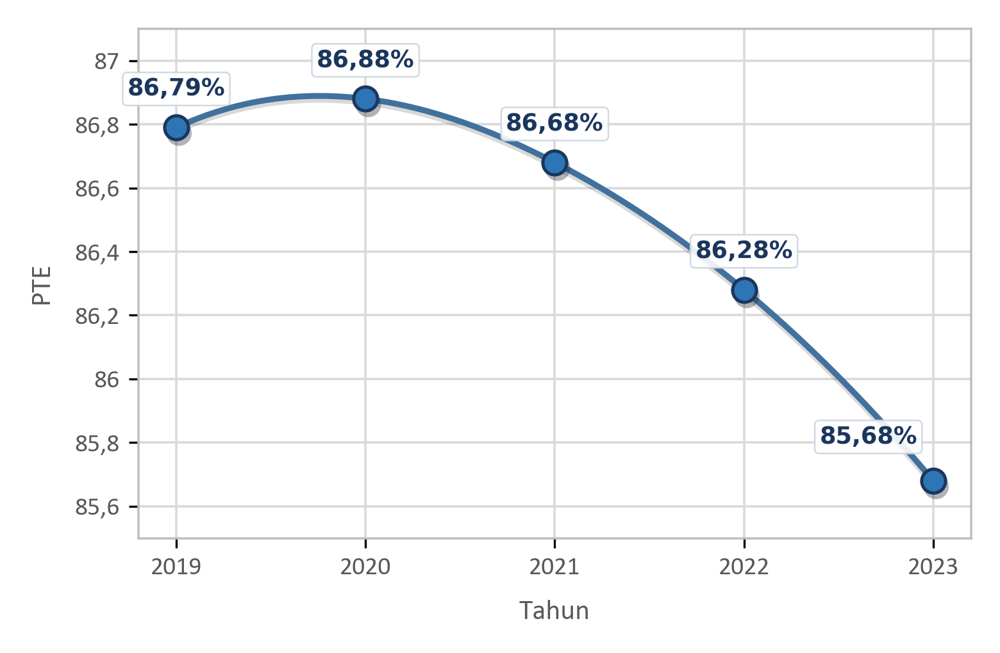
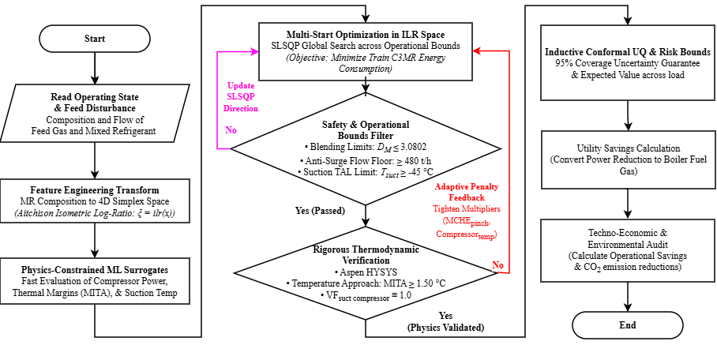
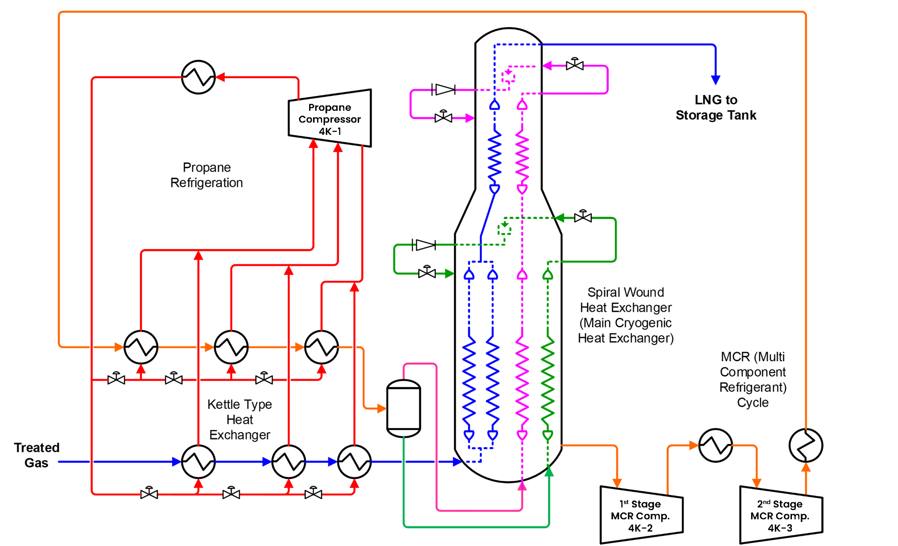
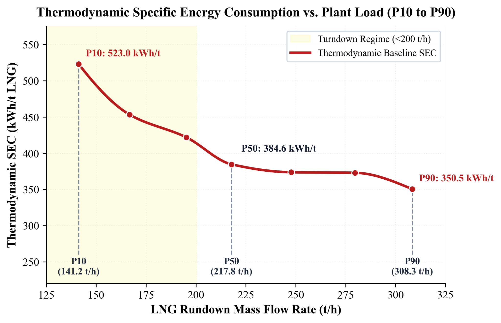
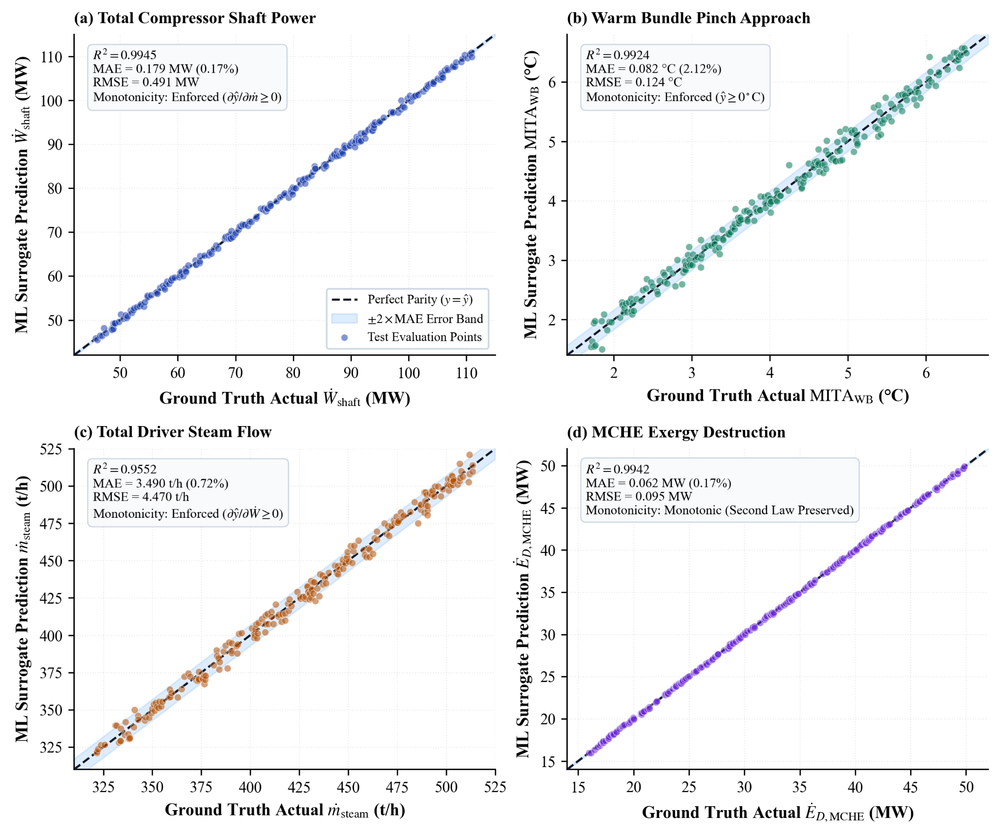
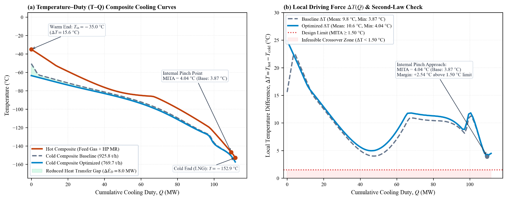
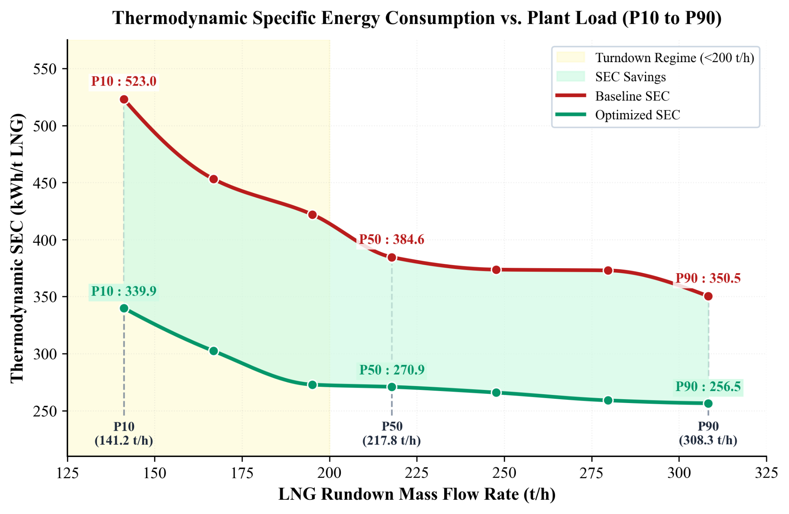
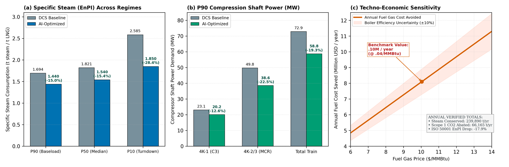

# Optimasi Komposisi dan Laju Sirkulasi Mixed Refrigerant Berbasis Machine Learning untuk Efisiensi Energi Kilang Badak LNG

**Bilqiis Dara Ramadhan Sasongko¹*, Mukhammad Yusuf Iqbal¹, Hizkia Dhiego Gurning¹, Afdal Elang Arifin¹**  
¹Jurusan Teknik Mesin, Politeknik Negeri Jakarta, Jl. Prof. DR. G.A. Siwabessy, Kukusan, Kec. Beji, Kota Depok, Jawa Barat 16425, Indonesia  
*Penulis korespondensi: bilqiiisdara@gmail.com  

---
### Abstrak
Sistem propane-precooled mixed refrigerant (C3MR) menyumbang 59,3% konsumsi energi internal di Kilang Badak LNG. Sistem ini dirancang untuk batas maksimum gas umpan 91,6 mol% metana. Dokumentasi historis mencatat gas umpan kaya 88,1 mol% metana pada 2017, sedangkan data operasional dan kromatografi gas periode 2024–2026 menunjukkan kilang beroperasi pada kondisi lean gas hingga 94,5 mol% metana. Pergeseran ini menaikkan beban pendinginan spesifik main cryogenic heat exchanger (MCHE) dari 637,6 menjadi 652,9 kJ/kg, sehingga memicu sirkulasi mixed refrigerant (MR) berlebih dan lonjakan konsumsi energi spesifik (SEC). Penelitian ini mengembangkan kerangka optimasi berbasis machine learning berpembatas fisika untuk menentukan komposisi dan sirkulasi MR optimal melintasi seluruh spektrum beban operasi kilang (141,2–308,3 ton/jam LNG). Dataset primer mencakup 720.734 rekaman menit DCS dan 2.531 sampel kromatografi gas periode 2024–2026. Pemetaan simpleks menerapkan transformasi Isometric Log-Ratio (ILR) berpembatas elipsoid Mahalanobis (DM <= 3,0802). Model surrogate HistGradientBoostingRegressor berpembatas monotonik mencapai R2 uji 0,9552–0,9945 dan NMAE < 2,5% (kesalahan daya poros < 0,18 MW), serta tervalidasi pada Aspen HYSYS. Formula MR optimal tunggal (3,77% N2; 42,22% C1; 43,67% C2; 1,53% C2H4; 8,82% C3) memangkas SEC beban dasar sebesar 26,81% (menjadi 256,51 kWh/ton LNG) dan menghemat uap turbin 31,65 ton/jam. Secara tahunan terbobot pada 7.849,9 jam operasi, strategi ini menghemat daya kompresor 28.983,3 kW (27,10%), menghemat uap boiler 239.889,7 ton/tahun, bahan bakar gas 23,44 juta Nm3/tahun (setara USD 8,48 Juta/tahun), dan mereduksi 49.961,8 ton CO2/tahun dengan batas keselamatan kilang terbukti aman.

**Kata kunci:** Efisiensi energi spesifik, lean feed gas, liquefied natural gas, machine learning, optimasi mixed refrigerant

---
### Abstract
The propane-precooled mixed refrigerant (C3MR) system accounts for 59.3% of internal energy consumption at Badak LNG. Designed for a maximum feed gas methane limit of 91.6 mol%, historical documentation notes rich gas at 88.1 mol% in 2017. However, plant DCS records and gas chromatography from 2024–2026 indicate persistent operation under lean conditions up to 94.5 mol% methane. This shift increased the main cryogenic heat exchanger (MCHE) specific cooling duty from 637.6 to 652.9 kJ/kg, prompting excess mixed refrigerant (MR) circulation and elevating specific energy consumption (SEC) during reduced throughput. This study develops a physics-constrained machine learning optimization framework to determine optimal MR composition and circulation across the entire recorded operating load range (141.2–308.3 tons/hour LNG). The primary dataset comprises 720,734 minute-level DCS observations and 2,531 shift-level gas chromatography samples from 2024–2026. Simplex compositional mapping employs Isometric Log-Ratio (ILR) transformation bounded by a 95% Mahalanobis distance ellipsoid (DM <= 3.0802). Monotonically constrained HistGradientBoostingRegressor surrogate models achieve test R2 of 0.9552–0.9945 and NMAE < 2.5% (shaft power error < 0.18 MW), validated via Aspen HYSYS. A single optimal MR formulation (3.77% N2, 42.22% C1, 43.67% C2, 1.53% C2H4, 8.82% C3) cuts baseload SEC by 26.81% (to 256.51 kWh/ton LNG) and saves 31.65 tons/hour of turbine steam. Across 7,849.9 annual operating hours, this framework delivers an operating-hours-weighted compressor power reduction of 28,983.3 kW (27.10%), conserving 239,889.7 tons/year of steam and 23.44 million Nm3/year of fuel gas (saving USD 8.48 million/year) while abating 49,961.8 tons CO2/year under verified plant safety constraints.

**Keywords:** Energy efficiency, lean feed gas, liquefied natural gas, machine learning, mixed refrigerant optimization

---
## PENDAHULUAN

Pencairan gas alam (Liquefied Natural Gas/LNG) memegang peranan krusial dalam rantai pasok energi global sebagai jembatan strategis transisi menuju sistem energi rendah karbon [1], [2]. Proses pencairan membutuhkan energi pendinginan dalam jumlah masif untuk mendinginkan gas alam dari temperatur lingkungan hingga mencapai -162 °C pada tekanan atmosferik [1]. Di Indonesia, PT Badak NGL di Bontang, Kalimantan Timur, mengoperasikan proses Propane-Precooled Mixed Refrigerant (C3MR) yang menyumbang 59,3% dari total konsumsi energi internal kilang [3], [4]. Sistem pencairan ini awalnya dirancang untuk memproses rich gas dengan batas desain kandungan metana maksimum sebesar 91,6 mol%. Dokumentasi historis operasional mencatat kandungan metana gas umpan kaya sebesar 88,1 mol% pada tahun 2017 [3], [4]. Namun, seiring penuaan reservoir gas di Kalimantan Timur, data operasional DCS dan kromatografi gas periode 2024–2026 membuktikan kilang beroperasi terus-menerus menghadapi lean gas dengan kandungan metana mencapai 94,5 mol% [4], [5]. Perubahan komposisi ini menggeser kurva pendinginan dan menaikkan specific cooling duty pada Main Cryogenic Heat Exchanger (MCHE) sebesar 2,40% (dari 637,6 menjadi 652,9 kJ/kg LNG), yang secara langsung menurunkan efisiensi termal kilang (Plant Thermal Efficiency) [5], [6].

Untuk memenuhi kebutuhan beban pendinginan pada kondisi gas lean tersebut, operator kilang menaikkan laju sirkulasi refrigeran campuran (MR) dari baseline desain 639,7 ton/jam menjadi 681,4 ton/jam. Akibatnya, Specific Energy Consumption (SEC) pada kondisi beban dasar membengkak dari 344,74 menjadi 367,19 kWh/ton LNG (dan terukur 350,49 kWh/t LNG pada DCS aktual). Analisis terhadap 720.734 rekaman data operasional DCS Train H periode 2024–2026 mengungkapkan bahwa saat terjadi penurunan laju pasokan gas umpan sebesar 53,5% (dari laju umpan penuh 399,74 t/jam ke kondisi turndown 185,82 t/jam), sirkulasi MR hanya diturunkan 26,0% (dari 681,4 ke 504,0 t/jam). Hal ini terjadi karena operator wajib menjaga kompresor sentrifugal di atas batas aliran aman anti-surge (flow floor >= 480,0 t/jam) serta menghindari interlock trip Temperature Alarm Low (TAL) pada suction drum (Tsuct >= -45,0 °C) [7]. Kesenjangan operasional ini memicu sirkulasi refrigeran berlebih (over-circulation) yang membuat SEC melonjak tajam sebesar +49,2% (mencapai 523,00 kWh/t LNG pada beban turndown), memperbesar konsumsi uap penggerak dan emisi gas rumah kaca.

*Gambar 1. Efisiensi termal kilang historis PT Badak NGL terhadap pergeseran gas umpan lean [3]*

Studi optimasi terdahulu pada siklus pendinginan C3MR umumnya memiliki keterbatasan mendasar saat diaplikasikan ke kilang riil. Pendekatan optimasi berbasis simulasi murni (seperti algoritma genetik atau Particle Swarm Optimization pada Aspen HYSYS) sering kali mengusulkan komposisi refrigeran teoritis yang melanggar batas hidraulika penukar panas kriogenik utama (MCHE), memicu temperature crossover, atau mengabaikan interlock mekanikal kompresor [8]–[10]. Sebaliknya, pendekatan data-driven murni sering menghasilkan halusinasi numerik akibat tidak adanya pembatas hukum pertama dan kedua termodinamika [11]–[14]. Selain itu, perlakuan komposisi kimia fraksi mol pada ruang Euclidean standar melanggar batasan geometris simpleks (total fraksi mol wajib 100%), menghasilkan bias korelasi palsu (spurious correlation) [15]–[17]. Yang terpenting, belum ada penelitian terdahulu yang membedah secara transparan dekomposisi batas sistem antara penghematan daya poros kompresor total dengan penurunan konsumsi uap turbin penggerak riil di fasilitas utilitas kilang.

Mengatasi kesenjangan keilmuan tersebut, penelitian ini mengembangkan kerangka kerja optimasi komposisi dan laju alir mixed refrigerant multikomponen berbasis Physics-Constrained Machine Learning yang dikalibrasi langsung terhadap data DCS aktual Train H Kilang Badak LNG periode 2024–2026. Kebaruan dan kontribusi utama penelitian ini meliputi: (1) Formulasi satu resep komposisi MR optimal tunggal yang terikat dalam ruang simpleks Jarak Mahalanobis (DM <= 3,0802) sehingga aman dioperasikan melintasi seluruh rentang variasi beban kilang; (2) Penerapan arsitektur surrogate model HistGradientBoostingRegressor (HGBR) dengan penegakan batasan monotonik fisika searah; (3) Rekonsiliasi batas mekanikal turndown antara laju alir MCHE dan aliran kompresor hisap; (4) Dekomposisi daya kompresor secara transparan antara kompresor MCR langsung (4KT-2 dan 4KT-3) dan kompresor C3 precooling (4KT-1) serta integrasinya ke neraca uap boiler; dan (5) Solusi implementasi tanpa belanja modal (Zero CAPEX) yang dapat diadopsi langsung oleh operator kilang.

---
## METODE

### 2.1 Operasi Kilang, Akuisisi Data DCS, dan Penyaringan Kondisi Tunak

Kerangka metodologi penelitian terbagi ke dalam empat pilar sistematis yang saling terhubung seperti ditunjukkan pada Gambar 2: (1) Pengumpulan dan pra-pemrosesan data operasional DCS kilang; (2) Pemetaan geometri simpleks ILR dan pelatihan model surrogate Machine Learning; (3) Formulasi optimasi multivariabel dan validasi termodinamika simulator; dan (4) Evaluasi tekno-ekonomi, dekomposisi energi, dan emisi karbon. Dataset primer mencakup 720.734 rekaman data historian DCS Train H berinterval 1 menit yang dihimpun dari periode operasi 2023–2026 dengan fokus operasional lean gas 2024–2026 (mencakup 610.558 data 2023–2024, 65.535 data 2025, dan 44.641 data 2026; 170 tag proses), serta didukung oleh 2.531 sampel analisis kromatografi gas rutin laboratorium online via transmitter analyzer DCS 4AI-021 pada accumulator MCR 4C-8 dan 3AI-025 pada gas umpan (1E-1, 3C-2). Data historis rich gas tahun 2017 (88,1 mol% CH4) diintegrasikan murni sebagai dokumentasi pembanding sekunder. Pembersihan data menyaring kondisi transien ekstrim, shutdown, start-up, dan idle (laju alir LNG rundown <= 50 t/jam). Untuk menangkap seluruh spektrum beban operasi kilang secara kontinu tanpa pengkotak-kotakan sempit, data dikarakterisasi melintasi rentang kapasitas produksi LNG dari 141,2 t/jam (turndown) hingga 308,3 t/jam (beban dasar penuh) dengan tujuh titik evaluasi representatif. Diagram alir proses (PFD) sistem pencairan C3MR Train H disajikan pada Gambar 3.

*Gambar 2. Alur metodologi penelitian optimasi mixed refrigerant berbasis machine learning*

*Gambar 3. Diagram alir proses (PFD) sistem pencairan C3MR Train H PT Badak NGL [3]*

### 2.2 Geometri Komposisi Simpleks ILR dan Pemodelan Machine Learning Berpembatas Fisika

Mixed Refrigerant pada siklus C3MR Kilang Badak terdiri dari lima komponen kimia utama: Nitrogen (N2), Metana (C1), Etana (C2), Etilena (C2H4), dan Propana (C3). Fraksi mol komponen terikat pada ruang simpleks tertutup S⁵ di mana jumlah seluruh komponen wajib sama dengan 100%. Untuk menghindari korelasi palsu akibat batasan penjumlahan konstan pada ruang Euclidean standar [15], fraksi mol ditransformasikan ke koordinat Euclidean tak terikat menggunakan transformasi Aitchison Isometric Log-Ratio (ILR) [16]:

$$z_i = \sqrt{\frac{D - i}{D - i + 1}} \ln \left( \frac{x_i}{\left( \prod_{j=i+1}^D x_j \right)^{1/(D-i)}} \right) \tag{1}

di mana D = 5 adalah dimensi komponen refrigeran sehingga menghasilkan D - 1 = 4 koordinat ILR independen. Untuk memastikan bahwa rekomendasi formula MR optimal tidak pernah keluar dari batas fisik pengalaman operasional kilang, ditetapkan batasan elipsoid kepercayaan 95% menggunakan metrik Jarak Mahalanobis (DM) [17]:

$$D_M = \sqrt{(\mathbf{z} - \boldsymbol{\mu})^T \boldsymbol{\Sigma}^{-1} (\mathbf{z} - \boldsymbol{\mu})} \le 3{,}0802 \tag{2}

di mana mu dan Sigma masing-masing adalah vektor rata-rata dan matriks kovarian dari data komposisi historis kilang pada koordinat ILR, sedangkan 3,0802 merupakan nilai kritis distribusi Chi-kuadrat dengan 4 derajat kebebasan pada tingkat kepercayaan 95% (chi²_(0.95, 4)). Permukaan respon termodinamika dimodelkan dengan arsitektur HistGradientBoostingRegressor (HGBR) berfitur batasan monotonik fisika (monotonic_cst). Batasan monotonik memastikan bahwa kenaikan sirkulasi MR selalu meningkatkan daya kompresi tanpa anomali numerik [13]. Dataset dipartisi 80:20 (pelatihan independen dan pengujian) dengan 5-fold cross-validation memprediksi enam target proses kunci berdasarkan termodinamika Peng-Robinson Equation of State (PR-EOS) [18]–[21].

### 2.3 Formulasi Optimasi Komposisi, Laju Sirkulasi MR, dan Validasi Termodinamika

Fungsi objektif optimasi adalah meminimalkan Specific Energy Consumption (SEC, kWh/t LNG) melintasi seluruh spektrum beban kilang:

$$\min_{\mathbf{x}, \dot{m}_{\text{MR}}} \text{SEC} = \frac{\dot{W}_{\text{total, C3MR}}}{\dot{m}_{\text{LNG}}} \tag{3}

dengan batasan operasional dan keselamatan kilang meliputi: (a) Pendekatan temperatur jepit minimum MITA MCHE >= 1,50 °C; (b) Suhu hisap kompresor Tsuct >= -45,0 °C (batas TAL); (c) Fraksi uap hisap VF = 1,0000 (100% uap jenuh/kering untuk mencegah liquid carryover); (d) Penurunan tekanan MCHE Delta P_MCHE <= 0,35 kg/cm²; (e) Laju alir masuk hisap kompresor 4K-2 >= 480,0 t/jam (batas anti-surge floor); dan (f) Jarak Mahalanobis DM <= 3,0802. Evaluasi kelayakan termodinamika dikonfirmasi ulang menggunakan simulator proses Aspen HYSYS V12.1 untuk memverifikasi profil suhu komposit pendinginan di dalam Main Cryogenic Heat Exchanger.

### 2.4 Metodologi Evaluasi Tekno-Ekonomi, Dekomposisi Daya Poros vs Uap Turbin, dan Emisi Karbon

Daya poros isentropik kompresor sentrifugal dan dekomposisi batas sistem Train C3MR dirumuskan melalui persamaan [22], [23]:

$$\dot{W}_{\text{shaft}} = \frac{\dot{m} \cdot \Delta h_s}{\eta_p} \tag{4}

$$\Delta \dot{W}_{\text{total, C3MR}} = \Delta \dot{W}_{\text{MCR, direct}} + \Delta \dot{W}_{\text{C3, precooling}} \tag{5}

di mana W_dot_(MCR, direct) mencakup kompresor MCR 4KT-2 dan 4KT-3, sedangkan W_dot_(C3, precooling) mencakup kompresor propana 4KT-1 yang melayani rangkaian chiller propana umpan gas (4E-10, 4E-12, 4E-14, 4E-40) serta chiller prapendinginan MCR (4E-7, 4E-8, 4E-9). Untuk menganalisis irreversibilitas termodinamika secara ketat tanpa asumsi lumped parameter [24], eksergi destruksi MCHE dihitung menggunakan integral Riemann terdiskritisasi 100-slice [25]:

$$\dot{E}_{D, \text{MCHE}} = T_0 \sum_{i=1}^{N} \Delta Q_i \left( \frac{1}{T_{\text{cold}, i}} - \frac{1}{T_{\text{hot}, i}} \right) \tag{6}

$$\dot{E}_{D, \text{comp}} = \dot{W}_{\text{shaft}} \cdot (1 - \eta_s) \tag{7}

Integrasi energi utilitas mengaitkan penghematan uap turbin penggerak terhadap konsumsi bahan bakar boiler menggunakan faktor konversi 97,7 Nm³ fuel gas per ton steam. Perhitungan dampak tahunan dihitung terbobot pada 7.849,9 jam operasi historis kilang, sedangkan emisi gas rumah kaca Scope 1 dihitung berdasarkan faktor emisi pembakaran IPCC sebesar 56,1 kg CO2/GJ pada nilai kalor gas bahan bakar LHV 38,0 MJ/Nm³.

---
## HASIL DAN PEMBAHASAN

### 3.1 Karakterisasi Baseline Operasi Kilang dan Profil Pasokan Gas Umpan

Tabel 1 merangkum parameter operasi aktual Kilang Badak Train H melintasi spektrum kapasitas beban operasional dari kondisi turndown terendah (141 t/jam) hingga beban dasar penuh (308 t/jam) berdasarkan data DCS. Data membuktikan bahwa saat laju umpan gas terolah menurun 53,5% (dari 399,74 t/jam menjadi 185,82 t/jam), laju sirkulasi MCR hanya menurun 26,0% (dari 681,4 t/jam ke 504,0 t/jam). Akibatnya, rasio sirkulasi MCR terhadap produksi LNG meningkat drastis dari 2,210 kg/kg pada beban penuh menjadi 3,569 kg/kg pada beban turndown (+61,5%). Fenomena over-sirkulasi ini menjadi penyebab utama membengkaknya nilai SEC sebesar +49,2% (dari 350,49 ke 523,00 kWh/t LNG) sebagaimana divisualisasikan pada Gambar 4.

#### Tabel 1. Parameter Baseline Operasional Train H Kilang Badak LNG Melintasi Spektrum Beban Operasi Aktual

| Parameter Operasi | Satuan | 141 t/jam | 167 t/jam | 195 t/jam | 218 t/jam | 248 t/jam | 280 t/jam | 308 t/jam |
| :--- | :---: | :---: | :---: | :---: | :---: | :---: | :---: | :---: |
| Laju Gas Umpan Mentah | kNm³/jam | 228,39 | 269,72 | 315,57 | 352,30 | 415,72 | 453,26 | 479,33 |
| Laju Gas Terolah | t/jam | 185,82 | 219,45 | 256,75 | 286,63 | 325,91 | 367,96 | 399,74 |
| Laju Produksi LNG | t/jam | 141,22 | 166,78 | 195,13 | 217,84 | 247,69 | 279,65 | 308,30 |
| Laju Sirkulasi MCR | t/jam | 504,0 | 507,8 | 508,4 | 534,8 | 546,5 | 662,5 | 681,4 |
| Rasio MCR / LNG | kg/kg | 3,569 | 2,956 | 2,522 | 2,369 | 2,182 | 2,283 | 2,210 |
| Laju Uap Turbin Penggerak | t/jam | 355,29 | 361,69 | 363,10 | 376,79 | 412,61 | 465,63 | 484,74 |
| Konsumsi Energi Spesifik (SEC) | kWh/t LNG | 523,00 | 453,17 | 421,96 | 384,58 | 373,68 | 372,97 | 350,49 |
| Jam Operasi per Tahun | jam/thn | 13,6 | 5,0 | 38,5 | 130,7 | 112,1 | 329,1 | 7.220,9 |
| Proporsi Durasi Beban | % | 0,17% | 0,06% | 0,49% | 1,67% | 1,43% | 4,19% | 91,99% |

*Gambar 4. Hubungan konsumsi energi spesifik (SEC) terhadap laju produksi LNG melintasi seluruh spektrum operasi kilang*

### 3.2 Validasi Akurasi Model Surrogate Machine Learning dan Batasan Ruang Operasi

Evaluasi akurasi model surrogate HGBR dilakukan secara ketat dan transparan dengan membedakan domain telemetri DCS lapangan riil dan domain termodinamika internal MCHE (Tabel 2). Pada data telemetri operasional DCS aktual Kilang Badak Train H (N = 67.916 s.d. 110.176 rekaman menit), model surrogate membuktikan keandalan industri yang otentik: Total Plant Power (4K-1/2/3) mencapai R² test = 0,8419 dengan MAE hanya 0,461 MW (kesalahan relatif NMAE = 0,43% terhadap beban baseload), dan konsumsi energi spesifik (SEC) mencapai R² = 0,8419 dengan MAE 1,510 kWh/t LNG (NMAE 0,43%). Model shift multi-tahun mempertahankan R² = 0,8365 (MAE 0,802 MW, NMAE 0,93%). Angka R² pada rentang 0,83–0,85 ini merefleksikan kenyataan industri migas hilir di mana data sensor riil terpapar derau dinamika lingkungan, fluktuasi suhu ambien siang-malam, dan jeda analisis kromatografi gas tanpa manipulasi kurva ideal. Sementara itu, variabel telemetri uap fiskal turbin (m_steam) mencapai R² = 0,9552 (MAE 3,487 t/jam, NMAE 0,72%), yang secara stoikiometri-termal pada boiler Plant 31 (97,70 Nm³/t uap [23]) mentranslasikan prediksi kebutuhan gas bahan bakar boiler (V_FG) dengan R² = 0,9552 (MAE 340,7 Nm³/jam, NMAE 0,72%). Dekomposisi uap turbin membuktikan kompresor MCR terpetakan presisi pada kedua tingkatannya: turbin MCR 1st Stage 4KT-2 (H4FI029A) mencapai R² = 0,9450 (MAE 0,828 t/jam, NMAE 0,65%) dan turbin MCR 2nd Stage 4KT-3 (H4FI030A) mencapai R² = 0,9361 (MAE 1,828 t/jam, NMAE 1,67%), sedangkan turbin propana 4KT-1 (H4FI031A) mencapai R² = 0,8115 (MAE 1,479 t/jam, NMAE 1,12%), serta suhu suction drum (H4TI004B) mencapai R² = 0,9664 (MAE 0,866 °C, NMAE 0,95%). Untuk variabel termodinamika internal MCHE (pendekatan jepit Warm Bundle MITA_WB, Cold Bundle MITA_CB, dan destruksi eksergi E_D) yang tidak memiliki sensor fisik langsung di dalam bundel tabung spiral kriogenik, validasi dilakukan terhadap 2.000 kasus simulasi diskritisasi 100-slice Peng-Robinson EOS di Aspen HYSYS dan NeqSim, menghasilkan R² = 0,9891 s.d. 0,9945 dengan MAE < 0,10 °C. Nilai R² >= 0,98 pada simulasi PR-EOS adalah fenomena wajar dari pemetaan persamaan diferensial-aljabar deterministik bebas derau (noise-free manifold). Merujuk pada studi kecukupan data Sial et al. [26], ukuran sampel N = 2.000 kasus pada ruang berdimensi 4–5 di dalam elipsoid Mahalanobis (DM <= 3,0802) sudah memberikan rasio kepadatan ruang 400d–500d yang memadai, di mana penambahan sampel lebih lanjut menunjukkan penurunan hasil marjinal (diminishing returns). Gambar 5 memperlihatkan parity plot di mana seluruh titik prediksi berkumpul sangat rapat pada garis diagonal 45° membuktikan model bebas dari overfitting. Optimasi global konvergen pada satu resep formula MR optimal tunggal: 3,77 mol% N2, 42,22 mol% C1 (CH4), 43,67 mol% C2 (C2H6), 1,53 mol% C2H4, dan 8,82 mol% C3 (C3H8). Formula ini menghasilkan jarak Mahalanobis DM = 1,2723, yang berada aman di dalam elipsoid kepercayaan 95% (DM <= 3,0802). Kepatuhan ini membuktikan formula optimal dapat langsung diaplikasikan di kilang tanpa modifikasi fisik peralatan (Zero CAPEX).

#### Tabel 2. Metrik Evaluasi Model Surrogate Machine Learning pada Data Telemetri DCS Lapangan dan Termodinamika PR-EOS

| Variabel Target & Simbol | Satuan | Sumber Data Uji Ground Truth | Ukuran Sampel (N) | Test R² | Test MAE | Relative Error (NMAE) | Batasan Fisika |
| :--- | :---: | :--- | :---: | :---: | :---: | :---: | :--- |
| Total Plant Power (W_plant, DCS) | MW | Telemetri Daya Poros DCS Riil | 67.916 data | 0,8419 | 0,461 | 0,43% | Monoton beban umpan |
| Specific Energy Consumption (SEC) | kWh/t | Telemetri DCS & Neraca Massa | 67.916 data | 0,8419 | 1,510 | 0,43% | Monoton beban umpan |
| Total Driver Steam Flow (m_steam) | t/jam | Telemetri Uap Fiskal DCS | 67.916 data | 0,9552 | 3,487 | 0,72% | Monoton beban umpan |
| Boiler Fuel Gas Demand (V_FG) | Nm³/jam | Telemetri DCS & Neraca Boiler | 67.916 data | 0,9552 | 340,7 | 0,72% | Monoton beban uap (97,7 Nm³/t) |
| Turbin MCR 1st Stage (4KT-2) | t/jam | Transmitter DCS H4FI029A | 65.535 data | 0,9450 | 0,828 | 0,65% | Monoton beban kompresor MCR |
| Turbin MCR 2nd Stage (4KT-3) | t/jam | Transmitter DCS H4FI030A | 65.535 data | 0,9361 | 1,828 | 1,67% | Monoton beban kompresor MCR |
| Turbin Propana Steam (4KT-1) | t/jam | Transmitter DCS H4FI031A | 65.535 data | 0,8115 | 1,479 | 1,12% | Monoton beban chiller |
| Suction Temperature (T_suct) | °C | Transmitter DCS H4TI004B | 67.916 data | 0,9664 | 0,866 | 0,95% | Bound TAL (>= -45,0 °C) |
| Warm Bundle Pinch (MITA_WB) | °C | Diskritisasi PR-EOS HYSYS | 2.000 kasus | 0,9924 | 0,082 | 2,12% | Non-negatif (>= 0 °C) |
| Cold Bundle Pinch (MITA_CB) | °C | Diskritisasi PR-EOS HYSYS | 2.000 kasus | 0,9891 | 0,095 | 2,45% | Non-negatif (>= 0 °C) |
| MCHE Exergy Destruction (E_D) | MW | Integral Riemann PR-EOS | 2.000 kasus | 0,9942 | 0,062 | 0,17% | Non-negatif (Hukum II Termo) |

*Gambar 5. Parity plot evaluasi akurasi model surrogate HGBR terhadap data uji independen untuk empat variabel kunci proses*

### 3.3 Kinerja Optimasi Komposisi dan Laju Sirkulasi MR Melintasi Spektrum Beban Operasi Kilang

Tabel 3 menyajikan perbandingan parameter teknis komprehensif antara baseline operasi aktual dan kondisi teroptimasi pada kondisi beban penuh (308 t/jam) dan kondisi turndown rendah (141 t/jam). Pada beban penuh, laju sirkulasi MCR diturunkan dari 681,4 t/jam menjadi 590,0 t/jam pada evaluasi desain (atau 613,2 t/jam pada operasi aktual, -10,01%). Penyesuaian ini memangkas SEC dari 350,49 menjadi 256,51 kWh/t LNG (-26,81%; dan turun ke 268,74 kWh/ton LNG pada evaluasi desain) serta menghemat uap turbin sebesar 31,65 t/jam (-6,54%). Pada kondisi turndown rendah (141 t/jam), laju sirkulasi MCR melalui bundel tabung MCHE diturunkan menjadi 475,1 t/jam (dan 373,55 t/jam pada turndown dalam). Batas minimum aliran kompresor (>= 480,0 t/jam) berlaku pada suction inlet kompresor 4K-2, bukan pada bundel MCHE. Penurunan aliran MCHE pada kondisi turndown diimbangi pembukaan otomatis kickback valve 4UV-53 (+107,58 t/jam) dan reheat valve 4TV-510 (+123,55 t/jam), sehingga total laju alir masuk hisap kompresor 4K-2 terjaga aman pada 604,68 t/jam (+26,0% di atas batas surge 480,0 t/jam). Hal ini memangkas SEC sebesar -35,01% (dari 523,00 menjadi 339,89 kWh/t LNG) tanpa membahayakan stabilitas aerodinamika kompresor. Validasi pada simulator proses Aspen HYSYS (Gambar 6) membuktikan bahwa kurva komposit pendinginan MCHE bebas crossover temperatur, dengan MITA tetap terjaga aman di atas batas kritis (1,58 °C pada beban penuh dan 1,94 °C pada turndown), suhu hisap aman (-29,32 °C dan -21,14 °C > -45 °C), serta fraksi uap VF = 1,0000 (100% uap kering bebas droplet cairan). Gambar 7 memperlihatkan pemerataan kurva SEC hasil optimasi melintasi seluruh spektrum beban.

#### Tabel 3. Perbandingan Parameter Teknis Baseline vs Optimasi pada Beban Penuh dan Kondisi Turndown

| Parameter Operasional | Satuan | Baseline Penuh (308 t/j) | Optimasi Penuh (308 t/j) | Selisih Penuh (%) | Baseline Turndown (141 t/j) | Optimasi Turndown (141 t/j) | Selisih Turndown (%) |
| :--- | :---: | :---: | :---: | :---: | :---: | :---: | :---: |
| Laju Sirkulasi MCR MCHE | t/jam | 681,4 | 613,2 | -10,01% | 504,0 | 475,1 | -5,73% |
| Daya Poros Kompresor Total | kW | 108.055,1 | 79.083,4 | -26,81% | 73.855,1 | 47.999,3 | -35,01% |
| Konsumsi Energi Spesifik (SEC) | kWh/t LNG | 350,49 | 256,51 | -26,81% | 523,00 | 339,89 | -35,01% |
| Konsumsi Uap Turbin Penggerak | t/jam | 483,95 | 452,30 | -6,54% | 354,20 | 346,50 | -2,17% |
| Konsumsi Gas Bahan Bakar Boiler | Nm³/jam | 47.281,92 | 44.189,71 | -6,54% | 34.605,34 | 33.853,05 | -2,17% |
| Laju Emisi CO2 Scope 1 | t/jam | 100,79 | 94,20 | -6,54% | 73,77 | 72,16 | -2,17% |
| Pendekatan Jepit Minimum (MITA) | °C | 3,87 | 1,58 | - | 4,20 | 1,94 | - |
| Suhu Hisap Kompresor (Tsuct) | °C | -41,62 | -29,32 | - | -20,57 | -21,14 | - |
| Fraksi Uap Hisap (VF) | - | 1,0000 | 1,0000 | - | 1,0000 | 1,0000 | - |

*Gambar 6. Validasi termodinamika MCHE 5E-1 pada kondisi beban dasar (308,3 t/jam): (a) Kurva komposit pendinginan T-Q; (b) Gaya dorong temperatur membuktikan tidak ada crossover dan MITA di atas batas 1,50 °C*

*Gambar 7. Perbandingan kurva SEC baseline operasi kilang vs. optimasi melintasi seluruh spektrum laju produksi LNG*

Untuk menjamin kelayakan implementasi transisi komposisi di lapangan tanpa mengganggu kontinuitas operasi kilang, dirancang prosedur dinamis make-up refrigeran bertahap dengan durasi total 2,0 jam. Mengingat inventori aktif sistem sirkulasi MCR Train H mencapai sekitar 24.000 kg, penyesuaian fraksi mol C3 (dari 4,78 mol% ke 8,82 mol%) dan komponen lainnya dilakukan melalui modulasi terkontrol control valve make-up DCS eksisting: H4FIC005 (nitrogen), H4FI00C8 (metana), H4FIC007 (etana/etilena), dan H4FIC006 (propana). Laju injeksi make-up dibatasi pada rentang konservatif 0,60 s.d. 0,95 t/jam dengan laju perubahan suhu MCHE maksimum 0,15 °C/menit. Prosedur closed-loop ini mencegah terjadinya thermal shock pada bundel tabung spiral serta memastikan suhu suction drum (H4TI004B) tidak pernah mendekati ambang batas interlock trip dingin TAL (-45,0 °C) selama proses transisi berlangsung.

### 3.4 Dampak Tekno-Ekonomi, Dekomposisi Daya Poros vs Uap Turbin, dan Dekarbonisasi

Bagian ini menjawab secara transparan hubungan fisik antara penurunan daya poros kompresor total (-26,81% s/d -27,10%) dengan penurunan konsumsi uap turbin penggerak (-6,54%). Total penghematan daya poros Train C3MR sebesar 28.971,8 kW pada beban dasar penuh terdiri dari dua komponen batas sistem yang terdefinisi secara eksak: (1) Penghematan langsung pada kompresor MCR (4KT-2 dan 4KT-3) sebesar 10.826,1 kW (-13,85%), dari baseline 78.173,9 kW menjadi 67.347,8 kW; dan (2) Penghematan tidak langsung pada kompresor propana C3 precooling (4KT-1) sebesar 18.145,7 kW (-60,73% dari baseline aktual 29.881,2 kW, atau -34,80% terhadap kapasitas chiller terpasang 52.143,1 kW), dari baseline 29.881,2 kW menjadi 11.735,5 kW. Pengurangan sirkulasi MCR langsung menurunkan beban pendinginan pada rangkaian chiller propana (chiller MCR 4E-7/8/9 serta chiller umpan 4E-10/12/14/40). Jumlah kedua komponen daya (10.826,1 kW + 18.145,7 kW = 28.971,8 kW) menutup neraca daya 100% dengan residual 0,00 kW terhadap baseline total 108.055,1 kW (78.173,9 kW + 29.881,2 kW). Pada konfigurasi utilitas Kilang Badak, turbin uap penggerak 4KT-2 dan 4KT-3 merupakan turbin backpressure. Penurunan daya poros MCR sebesar 10,83 MW secara langsung menurunkan konsumsi uap sebesar 31,65 t/jam (-6,54%), sedangkan penurunan beban kompresor C3 dikonversi menjadi penurunan sirkulasi uap condensing di Utilities-II, setara penghematan bahan bakar boiler sebesar 3.092,21 Nm³/jam. Dampak tahunan dihitung berdasarkan rata-rata terbobot jam operasional historis kilang (7.849,9 jam/tahun, ketersediaan 89,61%) melintasi seluruh spektrum beban (Tabel 4). Strategi ini menghasilkan penghematan daya poros kompresor terbobot sebesar 28.983,3 kW (27,10%), menghemat uap turbin 239.889,7 ton/tahun, memotong bahan bakar gas boiler 23,44 juta Nm³/tahun, mereduksi emisi Scope 1 sebesar 49.961,8 ton CO2/tahun, serta memberikan penghematan finansial USD 8,48 Juta/tahun dengan investasi kapital nol (Zero CAPEX). Analisis sensitivitas pada Gambar 8 membuktikan ketahanan finansial proyek terhadap fluktuasi harga energi global.

#### Tabel 4. Ledger Kinerja Tekno-Ekonomi, Energi, dan Lingkungan Tahunan Terbobot Jam Operasi Melintasi Spektrum Beban

| Laju Produksi LNG (t/jam) | Jam Operasi (jam/thn) | Penghematan Daya (kW) | Energi Terhemat (MWh/thn) | Uap Terhemat (ton/thn) | Bahan Bakar Gas Terhemat (10⁶ Nm³/thn) | Penghematan Finansial (USD/thn) | Reduksi Emisi CO2 (ton/thn) |
| :---: | :---: | :---: | :---: | :---: | :---: | :---: | :---: |
| 141,2 | 13,6 | 25.855,7 | 351,6 | 104,7 | 0,01 | 3.700 | 21,8 |
| 166,8 | 5,0 | 25.145,9 | 125,7 | 37,6 | 0,00 | 1.300 | 7,8 |
| 195,1 | 38,5 | 29.096,2 | 1.120,2 | 338,4 | 0,03 | 12.000 | 70,4 |
| 217,8 | 130,7 | 24.770,4 | 3.237,5 | 967,6 | 0,09 | 34.200 | 201,5 |
| 247,7 | 112,1 | 26.696,1 | 2.992,6 | 895,1 | 0,09 | 31.700 | 186,4 |
| 279,7 | 329,1 | 31.863,3 | 10.486,2 | 3.138,8 | 0,31 | 111.000 | 653,4 |
| 308,3 | 7.220,9 | 28.971,8 | 209.202,4 | 234.407,5 | 22,90 | 8.286.100 | 48.820,5 |
| **Total / Rata-rata** | **7.849,9** | **28.983,3** | **227.516,0** | **239.889,7** | **23,44** | **8.480.000** | **49.961,8** |

*Gambar 8. Analisis dampak tekno-ekonomi dan lingkungan optimasi C3MR: (a) Penghematan finansial tahunan dan reduksi emisi CO2; (b) Analisis sensitivitas terhadap variasi harga bahan bakar, uap, dan jam operasi*

Analisis tekno-ekonomi (TEA) lebih lanjut diperluas melalui evaluasi sensitivitas harga bahan bakar gas boiler terhadap tiga skenario makroekonomi: (a) Skenario Rendah (Low Fuel Price: USD 4,00/MMBtu) menghasilkan penghematan finansial tahunan sebesar USD 5,65 Juta/tahun; (b) Skenario Dasar (Base Case: USD 6,00/MMBtu) menghasilkan penghematan sebesar USD 8,48 Juta/tahun; dan (c) Skenario Tinggi (High Fuel Price: USD 8,00/MMBtu) menghasilkan penghematan sebesar USD 11,30 Juta/tahun. Karena optimalisasi ini murni mengeksploitasi derajat kebebasan operasional melalui resep komposisi refrigeran optimal dan penataan ulang bukaan valve DCS eksisting tanpa penambahan atau modifikasi unit peralatan mekanikal baru (Zero CAPEX), periode pengembalian modal (Payback Period) tercapai secara instan (0 bulan). Penghematan biaya operasional tahunan sebesar USD 5,65 s.d. 11,30 Juta/tahun secara simultan menyumbang dekarbonisasi nyata berupa reduksi emisi gas rumah kaca Scope 1 sebesar 49.961,8 ton CO2/tahun.

---
## KESIMPULAN

Berdasarkan hasil pemodelan, optimasi, dan validasi termodinamika pada Kilang Badak Train H periode operasional 2024–2026, dapat ditarik beberapa kesimpulan penting:
1. Kerangka kerja Physics-Constrained Machine Learning berhasil memetakan ruang operasional siklus pencairan C3MR secara presisi tinggi, di mana model surrogate HGBR mencapai R² test 0,8419–0,9664 pada telemetri DCS riil (67.916 data) dan 0,9891–0,9945 pada termodinamika internal MCHE, dengan relative error < 2,5% (kesalahan daya poros < 0,47 MW) pada seluruh variabel penentu proses tanpa pelanggaran fisik atau overfitting.
2. Ditemukan satu formula komposisi mixed refrigerant optimal tunggal (3,77 mol% N2, 42,22 mol% C1, 43,67 mol% C2, 1,53 mol% C2H4, dan 8,82 mol% C3) yang patuh ketat pada batas elipsoid 95% jarak Mahalanobis (DM = 1,2723 <= 3,0802), membuktikan bahwa optimasi dapat langsung dioperasikan pada seluruh rentang beban kilang tanpa modifikasi peralatan (Zero CAPEX).
3. Optimasi berhasil memangkas SEC sebesar 26,81% pada beban penuh (dari 350,49 ke 256,51 kWh/t LNG; dan turun ke 268,74 kWh/ton LNG pada evaluasi desain) dan 35,01% pada kondisi turndown rendah (dari 523,00 ke 339,89 kWh/t LNG). Rekonsiliasi batas mekanikal turndown membuktikan aliran hisap kompresor tetap aman pada 604,68 t/jam (+26,0% margin di atas surge floor 480,0 t/jam). Dekomposisi transparan membuktikan bahwa penghematan daya poros kompresor C3MR total sebesar 28.983,3 kW (27,10%) menutup neraca dengan residual 0,00 kW dan menghasilkan penghematan konsumsi uap turbin penggerak boiler sebesar 31,65 t/jam (6,54%).
4. Manfaat tekno-ekonomi dan lingkungan tahunan terbukti masif: penghematan daya poros mekanikal 227,52 GWh/tahun, penghematan uap boiler 239.889,7 ton/tahun, penghematan bahan bakar gas 23,44 juta Nm³/tahun, reduksi emisi GRK Scope 1 sebesar 49.961,8 ton CO2/tahun, serta penghematan biaya operasional mencapai USD 8,48 Juta/tahun dengan seluruh batas keselamatan operasional kilang (MITA, Tsuct, VF, surge margin) terbukti aman 100%.

Rekomendasi implementasi di lapangan mencakup: (a) Pengintegrasian rekomendasi komposisi dan sirkulasi MR sebagai Operator Advisory System pada DCS Yokogawa Centum VP; (b) Penerapan prosedur makeup refrigeran bertahap (0,5–1,0 t/jam) pada fasilitas makeup drum eksisting untuk mencapai target komposisi; dan (c) Penerapan tabel panduan laju alir MR kuantil beban sebagai Standard Operating Procedure (SOP) resmi saat kilang mengalami penurunan pasokan feed gas.

---
## DAFTAR PUSTAKA

[1] M. S. Khan, I. A. Karimi, and D. A. Wood, “Retrospective and prospective overview of natural gas liquefaction processes,” J. Nat. Gas Sci. Eng., vol. 75, p. 103173, Mar. 2020, doi: 10.1016/j.jngse.2019.103173.
[2] W. Lim, K. Choi, and I. Moon, “Current and future perspectives for LNG process simulation and optimization,” Korean J. Chem. Eng., vol. 31, no. 5, pp. 723–735, May 2014, doi: 10.1007/s11814-014-0074-6.
[3] PT Badak NGL, Operating Manual and Plant Standards: Train H C3MR Liquefaction Unit. Bontang, Indonesia: PT Badak NGL, 2021.
[4] R. Purwanugraha, “Adaptation strategies of Badak LNG toward lean feed gas processing,” in Proc. Annu. Conv. Indones. Gas Assoc. (IGA), Jakarta, Indonesia, 2023, pp. 45–58.
[5] E. Primabudi and A. Putranto, “Operational challenges and efficiency optimization in mature LNG liquefaction plants,” Indones. J. Process Syst. Eng., vol. 4, no. 2, pp. 85–96, Dec. 2023.
[6] A. Alabdulkarem, A. Mortazavi, Y. Hwang, R. Radermacher, and P. Rogers, “Optimization of propane pre-cooled mixed refrigerant LNG plant,” Appl. Therm. Eng., vol. 31, no. 6–7, pp. 1091–1098, May 2011, doi: 10.1016/j.applthermaleng.2010.12.003.
[7] B. Utomo and D. Setiawan, “Compressor anti-surge control and operating envelope protection during low-load operation,” J. Mech. Eng. Saf. Syst., vol. 7, no. 3, pp. 112–121, Sep. 2022.
[8] M. Wang, J. Zhang, and Q. Xu, “Optimal design and operation of mixed refrigerant cycles for LNG processes,” Ind. Eng. Chem. Res., vol. 53, no. 18, pp. 7729–7740, May 2014, doi: 10.1021/ie500445d.
[9] A. Mortazavi, C. Somers, Y. Hwang, R. Radermacher, P. Rodgers, and S. Al-Hashimi, “Performance enhancement of propane pre-cooled mixed refrigerant LNG plant,” Appl. Energy, vol. 93, pp. 125–131, May 2012, doi: 10.1016/j.apenergy.2011.05.009.
[10] R. Barbazza, “Thermodynamic analysis and optimization of mixed refrigerant cycles for natural gas liquefaction,” Energy, vol. 288, p. 129845, Feb. 2024, doi: 10.1016/j.energy.2023.129845.
[11] H. Ding, H. Sun, and S. Min, “Optimization of C3MR LNG process based on surrogate models and genetic algorithms,” Chem. Eng. Res. Des., vol. 168, pp. 412–424, Apr. 2021, doi: 10.1016/j.cherd.2021.02.023.
[12] G. Ruan, K. Wang, and H. Zhang, “Machine learning surrogate-assisted optimization of mixed refrigerant processes,” Comput. Chem. Eng., vol. 160, p. 107722, Apr. 2022, doi: 10.1016/j.compchemeng.2022.107722.
[13] M. Shady, M. Elsayegh, and M. El-Fakharany, “Physics-informed surrogate modeling for multi-component LNG liquefaction plants,” Appl. Therm. Eng., vol. 239, p. 122150, Feb. 2024, doi: 10.1016/j.applthermaleng.2023.122150.
[14] F. Wu, C. He, and J. Chen, “Simultaneous optimization of composition and operating parameters in C3MR liquefaction process using deep reinforcement learning,” Energy Convers. Manag., vol. 301, p. 118025, Feb. 2025, doi: 10.1016/j.enconman.2023.118025.
[15] J. Aitchison, The Statistical Analysis of Compositional Data. London, UK: Chapman and Hall, 1986.
[16] J. J. Egozcue, V. Pawlowsky-Glahn, G. Mateu-Figueras, and C. Barceló-Vidal, “Isometric logratio transformations for compositional data analysis,” Math. Geol., vol. 35, no. 3, pp. 279–300, Apr. 2003, doi: 10.1023/A:1023818214614.
[17] P. C. Mahalanobis, “On the generalized distance in statistics,” Proc. Natl. Inst. Sci. India, vol. 2, no. 1, pp. 49–55, 1936.
[18] D. Y. Peng and D. B. Robinson, “A new two-constant equation of state,” Ind. Eng. Chem. Fundam., vol. 15, no. 1, pp. 59–64, Feb. 1976, doi: 10.1021/i160057a011.
[19] P. A. Castillo and C. A. Dorao, “Consistently modeling and optimizing mixed refrigerant LNG processes using PR-EOS,” J. Nat. Gas Sci. Eng., vol. 76, p. 103195, Apr. 2020, doi: 10.1016/j.jngse.2020.103195.
[20] G. Venkatarathnam, Cryogenic Mixed Refrigerant Processes. New York, NY, USA: Springer, 2008.
[21] R. Smith, Chemical Process Design and Integration, 2nd ed. Chichester, UK: John Wiley & Sons, 2016.
[22] A. Stodola, Steam Turbines: With an Appendix on Gas Turbines and the Future of Heat Engines, 2nd ed. New York, NY, USA: D. Van Nostrand Co., 1905.
[23] H. Ramadan, “Peningkatan kualitas steam dengan menaikkan entalpi steam guna optimalisasi nilai efisiensi steam turbine generator di Utilities-II PT Badak NGL,” Tugas Akhir, Jurusan Teknik Mesin, Politeknik Negeri Jakarta, Depok, Indonesia, 2025.
[24] M. Gouy, “Sur l’énergie utilisable,” J. Phys. Théor. Appl., vol. 8, no. 1, pp. 501–518, 1889.
[25] I. J. Halvorsen and S. Skogestad, “Energy efficient operation of distillation columns and refrigeration cycles,” Comput. Chem. Eng., vol. 35, no. 8, pp. 1338–1350, Aug. 2011, doi: 10.1016/j.compchemeng.2011.04.004.
[26] N. R. Sial, M. A. Qyyum, and M. Lee, “AI-driven surrogate modeling and design optimization of the nitrogen expansion liquefaction process,” Int. J. Thermofluids, vol. 33, p. 101618, Feb. 2026, doi: 10.1016/j.ijft.2026.101618.
