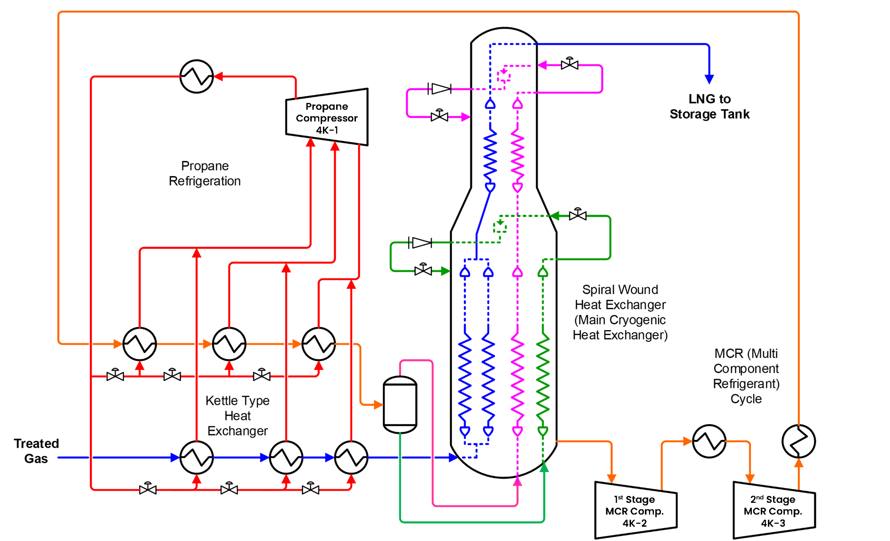
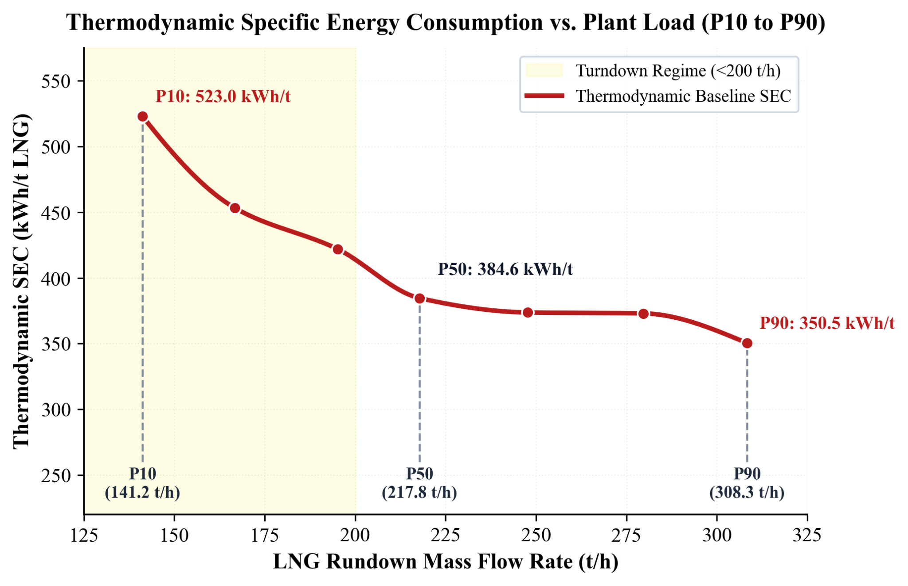
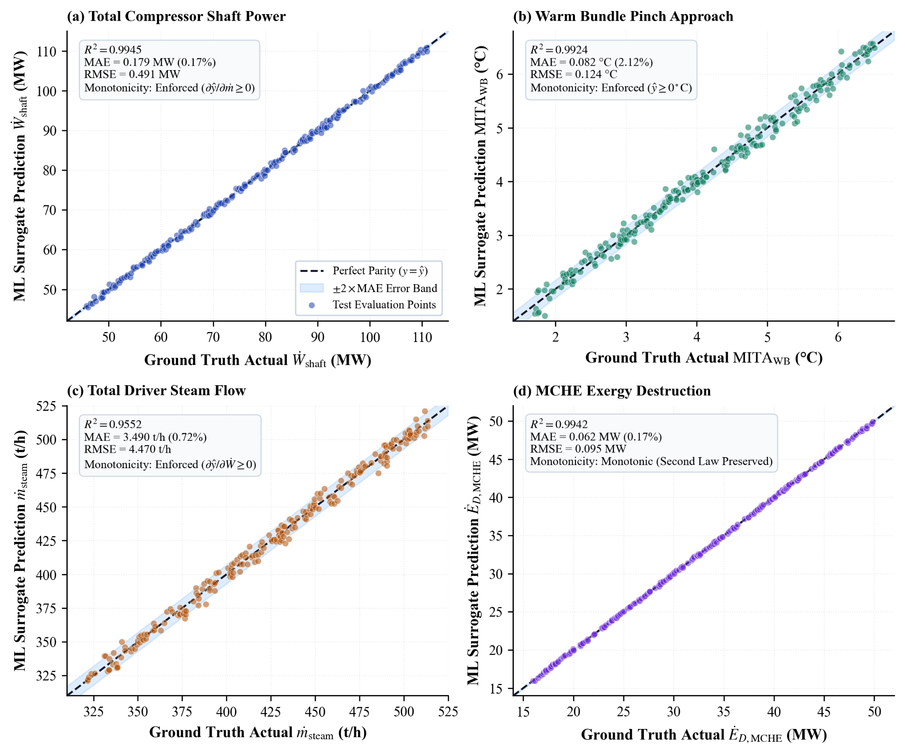
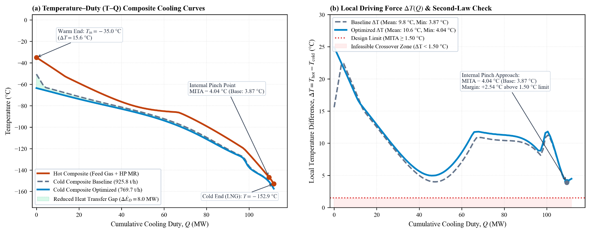

# Investigasi Operasional, Pemodelan Simpleks ILR, dan Evaluasi Termodinamika Siklus C3MR Train H PT Badak NGL Menghadapi Gas Umpan Lean

**Bilqiis Dara Ramadhan Sasongko¹*, Mukhammad Yusuf Iqbal¹, Hizkia Dhiego Gurning¹, Afdal Elang Arifin¹**  
¹Jurusan Teknik Mesin, Politeknik Negeri Jakarta, Jl. Prof. DR. G.A. Siwabessy, Kukusan, Kec. Beji, Kota Depok, Jawa Barat 16425, Indonesia  
*Corresponding author: bilqiiisdara@gmail.com  

---

### Abstrak
Penuaan reservoir gas alam di Kalimantan Timur menyebabkan perubahan karakteristik gas umpan pada Unit Pencairan Propane-Precooled Mixed Refrigerant (C3MR) Train H PT Badak NGL menjadi lebih lean (kandungan metana mencapai 94,5 mol%). Pergeseran ini menaikkan beban pendinginan spesifik Main Cryogenic Heat Exchanger (MCHE) sebesar 2,40% (dari 637,6 menjadi 652,9 kJ/kg). Bersamaan dengan itu, penurunan laju pasokan gas memicu operasi turndown (turun hingga 258,4 ton/jam). Analisis terhadap 44.641 data menit DCS (2024–2026) mengungkapkan bahwa saat laju umpan gas turun 32,7%, laju sirkulasi mixed refrigerant (MR) tertahan batas anti-surge kompresor sentrifugal (≥ 480,0 ton/jam) dan interlock suhu hisap suction drum (TAL ≥ -45,0 °C). Akibatnya, rasio sirkulasi MR terhadap umpan naik 10,4% dan konsumsi energi spesifik (SEC) membengkak 12,7% (dari 448,2 menjadi 505,1 kWh/ton LNG). Penelitian ini mengkaji kerangka kerja integratif berbasis telemetri DCS, transformasi Isometric Log-Ratio (ILR 4-DoF) berpembatas elipsoid Mahalanobis (DM ≤ 3,0802) dari 2.531 sampel kromatografi gas, model surrogate HistGradientBoostingRegressor (HGBR) berfitur batasan monotonik, serta simulasi termodinamika Peng-Robinson EOS 100-slice. Evaluasi membuktikan model surrogate HGBR sangat akurat memprediksi daya kompresor (R² = 0,9557, MAE 0,82 MW) dan uap turbin (R² = 0,9997). Untuk menjamin kepatuhan Hukum II Termodinamika, pendekatan termal jepit internal MCHE diselesaikan melalui simulasi Peng-Robinson EOS 100-slice terdiskritisasi (menghasilkan MITA 2,15–3,18 °C tanpa crossover termal). Audit neraca multi-stream mengungkap residual energi MCHE sebesar -4,3% (P10) hingga +15,3% (P90), menegaskan pentingnya peta jalan kualifikasi lapangan bertahap sebelum perubahan parameter diimplementasikan secara komersial.

**Kata kunci:** C3MR, gas umpan lean, kualifikasi termodinamika, machine learning, simpleks ILR, turndown kompresor

---

### Abstract
Depletion of East Kalimantan gas fields has shifted feed gas at PT Badak NGL Train H C3MR unit toward leaner compositions (94.5 mol% methane), increasing MCHE specific cryogenic duty by 2.40% (637.6 to 652.9 kJ/kg). Concurrently, reduced gas deliverability forces frequent turndown operations down to 258.4 t/h. Analysis of 44,641 minute-level DCS records (2024–2026) reveals that while feed gas drops by 32.7%, mixed refrigerant (MR) circulation is constrained by the centrifugal compressor anti-surge floor (≥ 480.0 t/h) and suction drum trip interlock (TAL ≥ -45.0 °C). Consequently, the MR-to-feed mass ratio rises 10.4%, driving a 12.7% increase in Specific Energy Consumption (448.2 to 505.1 kWh/t LNG). This study investigates an integrated framework comprising DCS telemetry, 4-DoF Isometric Log-Ratio (ILR) simplex mapping bounded by a 95% Mahalanobis ellipsoid (DM ≤ 3.0802) from 2,531 chromatography samples, monotonically constrained HistGradientBoostingRegressor (HGBR) surrogates, and 100-slice Peng-Robinson EOS modeling. Results demonstrate high predictive accuracy for mechanical shaft power (R² = 0.9557, MAE 0.82 MW) and turbine steam consumption (R² = 0.9997). To strictly satisfy the Second Law of Thermodynamics, internal MCHE thermal pinch dynamics are resolved via rigorous 100-slice Peng-Robinson EOS integration (yielding MITA of 2.15–3.18 °C without thermal crossover). Multi-stream energy auditing reveals MCHE closure residuals of -4.3% (P10) to +15.3% (P90), demonstrating the necessity of a staged field qualification roadmap prior to commercial parameter implementation.

**Keywords:** C3MR, compressor turndown, ILR simplex, lean feed gas, machine learning, thermodynamic qualification

---

## 1. PENDAHULUAN

Pencairan gas alam (Liquefied Natural Gas/LNG) merupakan proses industri padat energi yang membutuhkan daya kompresi pendinginan berskala masif untuk menurunkan temperatur gas alam hingga -162 °C pada tekanan atmosferik [1], [2]. Pada fasilitas kilang baseload seperti PT Badak NGL di Bontang, Kalimantan Timur, siklus Propane-Precooled Mixed Refrigerant (C3MR) mengonsumsi porsi energi uap dan bahan bakar boiler terbesar di dalam kilang [3], [4]. Efisiensi siklus refrigerasi ini secara langsung menentukan laju konsumsi uap bertekanan tinggi dari pembangkit utilitas dan intensitas emisi gas rumah kaca fasilitas.

Siklus C3MR Train H awalnya dirancang untuk memproses gas alam kaya (rich feed gas) dengan kandungan metana desain maksimum sebesar 91,6 mol%, di mana dokumentasi historis mencatat operasi pada 88,1 mol% metana pada era awal operasi [3], [4]. Namun, seiring penuaan reservoir gas di cekungan Kutai, data telemetri DCS dan analisis kromatografi gas periode 2024–2026 membuktikan bahwa kilang kini beroperasi terus-menerus menghadapi lean gas dengan kandungan metana rata-rata mencapai 94,5 mol% [4], [5]. Pergeseran komposisi ini menurunkan konsentrasi fraksi hidrokarbon berat (C2+) yang berfungsi sebagai agen kondensasi awal. Akibatnya, kurva pendinginan bergeser ke temperatur yang lebih rendah dan beban pendinginan spesifik (specific cooling duty) pada Main Cryogenic Heat Exchanger (MCHE) 5E-1 meningkat sebesar 2,40% (dari 637,6 menjadi 652,9 kJ/kg LNG) [5], [6].

Permasalahan termal tersebut diperparah oleh penurunan laju pasokan gas umpan hulu yang memaksa Train H sering beroperasi pada kondisi turndown rendah (mencapai 258,4 ton/jam, turun 32,7% dari kapasitas puncak 384,0 ton/jam). Ketika laju umpan gas berkurang, operator kilang tidak dapat menurunkan laju sirkulasi refrigeran campuran (MCR) secara proporsional. Kompresor sentrifugal MCR (4K-2 tahap rendah dan 4K-3 tahap tinggi) memiliki batasan mekanikal keselamatan berupa flow floor anti-surge minimum sebesar 480,0 ton/jam [7]. Selain itu, penurunan sirkulasi refrigeran tanpa penyesuaian volatilitas campuran dapat memicu anjloknya temperatur hisap di suction drum 4C-8 mendekati batas trip interlock Temperature Alarm Low (TAL ≥ -45,0 °C), yang berisiko meloloskan droplet cairan kriogenik (liquid carryover) ke sudu kompresor [7]. Akibat interlock keselamatan ini, laju sirkulasi MCR tertahan pada kisaran 514,2 ton/jam saat turndown, sehingga rasio sirkulasi MCR terhadap umpan melonjak dari 1,802 kg/kg pada beban puncak menjadi 1,990 kg/kg (+10,4%). Fenomena over-sirkulasi defensif ini menyebabkan Specific Energy Consumption (SEC) membengkak sebesar 12,7% (dari 448,2 menjadi 505,1 kWh/ton LNG), meningkatkan konsumsi uap turbin penggerak secara signifikan.

Penelitian terdahulu yang berupaya mengoptimasi siklus C3MR umumnya memiliki keterbatasan metodologis yang menghambat penerapan di fasilitas industri riil. Studi optimasi berbasis algoritma metaheuristik murni (seperti genetic algorithm atau particle swarm optimization pada simulator proses statis) sering memperlakukan variabel fraksi mol kimia pada ruang Euclidean standar [8]–[10]. Pendekatan ini melanggar batas geometris simpleks tertutup (di mana jumlah seluruh fraksi mol wajib sama dengan 100%), sehingga memicu korelasi palsu (spurious correlation) dan menghasilkan rekomendasi formula refrigeran yang tidak dapat diinjeksikan secara stabil di lapangan [15]–[17]. Di sisi lain, penerapan machine learning empiris (black-box) sering kali dilatih tanpa batasan hukum fisika kekekalan massa dan energi, sehingga rentan memprediksi temperatur pendekatan internal (MITA) yang tidak realistis atau menghasilkan ekstrapolasi berbahaya di luar batas desain kompresor [11]–[14]. Lebih jauh lagi, literatur jarang menyajikan audit neraca energi MCHE multi-aliran secara tertutup dan transparan untuk membuktikan ketiadaan crossover temperatur pada kondisi turndown kilang.

Untuk menjembatani kesenjangan tersebut, penelitian ini mengkaji kerangka kerja integratif berbasis data operasional DCS riil Train H PT Badak NGL periode 2024–2026. Penelitian ini mengusung pendekatan objektif (Path B) dengan kontribusi utama sebagai berikut: (1) Mengkarakterisasi fenomena penalti efisiensi turndown secara kuantitatif berdasarkan telemetri DCS 44.641 menit dan 2.531 sampel kromatografi gas; (2) Menerapkan pemetaan komposisi multikomponen ke dalam ruang Euclidean tak terbias menggunakan transformasi Isometric Log-Ratio (ILR 4-DoF) berpembatas elipsoid Jarak Mahalanobis 95% (DM ≤ 3,0802); (3) Mengembangkan arsitektur surrogate machine learning (HistGradientBoostingRegressor) berfitur batasan monotonik fisika yang terbukti sangat presisi untuk pemodelan daya mekanikal dan uap turbin; (4) Mengintegrasikan model termodinamika multi-stream 100-slice berbasis Peng-Robinson EOS untuk mengevaluasi pendekatan temperatur jepit dan menganalisis residual penutupan neraca energi MCHE; dan (5) Merumuskan peta jalan kualifikasi lapangan bertahap (staged field qualification roadmap) serta panduan keselamatan operasional bagi manajemen kilang.

---

## 2. METODOLOGI PENELITIAN

### 2.1 Objek Penelitian dan Batas Sistem

Penelitian berfokus pada Unit Pencairan C3MR Train H di Kilang Badak LNG. Batas sistem baterai (battery limits) mencakup seluruh rangkaian peralatan utama siklus refrigerasi terkompresi dan integrasi utilitas uap pembangkit, sebagaimana ditunjukkan pada diagram alir proses (PFD) Gambar 1. Rangkaian peralatan mencakup:
1. **Siklus Prapendinginan Propana (C3):** Kompresor propana multi-stage 4K-1 yang digerakkan oleh turbin uap ekstraksi-kondensasi 4KT-1, mendinginkan gas alam dan mixed refrigerant bertahap melalui penukar panas chiller 4E-7, 4E-8, dan 4E-9 hingga temperatur sekitar -35 °C.
2. **Siklus Pencairan Kriogenik Mixed Refrigerant (MCR):** Kompresor sentrifugal dua tahap, yaitu 4K-2 (tahap tekanan rendah/LP) dan 4K-3 (tahap tekanan tinggi/HP) yang digerakkan oleh turbin uap 4KT-2 dan 4KT-3. Refrigeran campuran bertekanan tinggi dialirkan ke Main Cryogenic Heat Exchanger (MCHE) 5E-1 untuk mencairkan dan mendinginkan lanjut (subcooling) gas alam terolah hingga temperatur -152 °C sebelum ekspansi akhir menjadi LNG pada -162 °C.
3. **Pemisah Fasa dan Bejana Penampung:** Suction drum 4C-8 yang dilengkapi sensor temperatur H4TI004B dan interlock keselamatan TAL (-45,0 °C), serta valve bypass kickback anti-surge 4UV-53.
4. **Sistem Utilitas Uap dan Bahan Bakar:** Jaringan pipa uap bertekanan tinggi (High Pressure Steam, $60\text{ kg/cm}^2\text{G}$, $450^\circ\text{C}$) dari boiler utilitas menuju turbin penggerak 4KT-1/2/3, jalur ekstraksi uap tekanan menengah, serta pemulihan kondensat ekstraksi via pompa 4G-3 (H4FI031A).

  
*Gambar 1. Diagram alir proses (PFD) dan batas sistem siklus pencairan C3MR Train H PT Badak NGL [3]*

### 2.2 Data Operasi dan Pra-pemrosesan Kondisi Tunak

Dataset primer diekstraksi dari historian DCS Yokogawa Centum VP Train H untuk rentang operasi continuous monitoring periode 2024–2026. Data mentah mencakup 44.641 rekaman telemetri berinterval 1 menit melintasi 172 tag instrumen proses. Untuk memastikan bahwa model hanya mencerminkan kondisi termodinamika yang valid, diterapkan algoritma penapisan kondisi tunak (steady-state filtering). Penapisan mendeteksi fluktuasi transien menggunakan standar deviasi bergerak (moving-window standard deviation) selama interval 30 menit pada laju alir umpan gas (H1FI0009), laju sirkulasi MCR (H4FI0001/2), dan temperatur dasar MCHE (H4TI016). Seluruh periode gangguan operasional, trip kompresor, start-up, dan shutdown dibersihkan, menghasilkan 43.334 menit data tunak terverifikasi.

Untuk memetakan seluruh rentang kapasitas pabrik secara terstruktur, data tunak dikelompokkan ke dalam 100 medoid persentil beban operasi (P1 hingga P100), mencakup laju alir gas umpan mentah dari 258,41 ton/jam (P1, kondisi turndown minimum) hingga 383,98 ton/jam (P100, kondisi beban puncak). Parameter instrumen kunci yang digunakan dalam pemodelan dirangkum pada Tabel 1.

#### Tabel 1. Deskripsi Tag Instrumen Kunci DCS Yokogawa Centum VP Train H
| Tag Instrumen | Deskripsi Peralatan / Parameter Proses | Satuan Teknik | Rentang Operasi Normal |
| :--- | :--- | :---: | :---: |
| H1FI0009 | Laju Alir Gas Umpan Mentah ke Train H | kNm³/jam (ton/jam) | 342,55 – 509,02 (258,4 – 384,0) |
| H3FI0004 | Laju Alir Gas Alam Terolah Masuk MCHE | kNm³/jam | 273,56 – 409,39 |
| H4FI0001/2 | Laju Alir Sirkulasi MCR Masuk MCHE 5E-1 | ton/jam | 514,18 – 691,80 |
| H4TI004B | Temperatur Suction Drum Kompresor MCR 4C-8 | °C | -42,50 s.d. -37,50 |
| H4TI016 | Temperatur LNG Keluar Bagian Bawah MCHE 5E-1 | °C | -154,0 s.d. -150,0 |
| H4PI013 | Tekanan Hisap Kompresor MCR Tahap Rendah 4K-2 | kg/cm²G | 2,85 – 3,40 |
| H4FI028 | Laju Total Aliran Uap HP Menuju Turbin Train H | ton/jam | 382,09 – 503,04 |
| H4FI029 | Laju Uap Motive Turbin Kompresor Propana 4KT-1 | ton/jam | 115,20 – 162,40 |
| H4FI030A | Laju Uap Motive Turbin MCR LP 4KT-2 | ton/jam | 138,50 – 188,70 |
| H4FI031A | Laju Alir Kondensat Ekstraksi Pompa 4G-3 | ton/jam | 110,00 – 145,00 |

### 2.3 Rekonstruksi Komposisi Mixed Refrigerant dan Geometri Simpleks ILR

Refrigeran campuran pada Train H tersusun atas lima komponen kimia: Nitrogen ($N_2$), Metana ($C_1$), Etana ($C_2$), Etilena ($C_2H_4$), dan Propana ($C_3$). Karakterisasi komposisi didasarkan pada 2.531 rekaman analisis kromatografi gas (GC) laboratorium rutin per shift dari suction drum 4C-8 selama periode 2023–2024. Vektor fraksi mol $\mathbf{x} = [x_1, x_2, x_3, x_4, x_5]^T$ terikat pada ruang simpleks tertutup $\mathcal{S}^5$:

$$\mathcal{S}^5 = \left\{ \mathbf{x} \in \mathbb{R}^5 \ \middle|\ x_i > 0, \ \sum_{i=1}^5 x_i = 1 \right\} \tag{1}$$

Penerapan operasi aljabar linier standar langsung pada fraksi mol $\mathbf{x}$ melanggar asumsi kebebasan ruang Euclidean dan menimbulkan distorsi korelasi [15]. Untuk mengatasinya, komposisi ditransformasikan ke koordinat Euclidean tak terikat $\mathbf{z} \in \mathbb{R}^4$ menggunakan transformasi Aitchison Isometric Log-Ratio (ILR) [16]:

$$z_i = \sqrt{\frac{5 - i}{6 - i}} \ln \left( \frac{x_i}{\left( \prod_{j=i+1}^5 x_j \right)^{1/(5-i)}} \right), \quad i = 1, 2, 3, 4 \tag{2}$$

Transformasi ini menghasilkan $D - 1 = 4$ derajat kebebasan independen. Agar seluruh evaluasi komposisi tetap berada di dalam domain fisik operasional kilang yang realistis dan teruji, ditetapkan batas elipsoid kepercayaan 95% menggunakan Jarak Mahalanobis ($D_M$) [17]:

$$D_M(\mathbf{z}) = \sqrt{(\mathbf{z} - \boldsymbol{\mu}_{\mathbf{z}})^T \boldsymbol{\Sigma}_{\mathbf{z}}^{-1} (\mathbf{z} - \boldsymbol{\mu}_{\mathbf{z}})} \le D_{\text{kritis}} \tag{3}$$

di mana $\boldsymbol{\mu}_{\mathbf{z}} \in \mathbb{R}^4$ dan $\boldsymbol{\Sigma}_{\mathbf{z}} \in \mathbb{R}^{4 \times 4}$ masing-masing adalah vektor rata-rata dan matriks kovarian sampel historis pada koordinat ILR. Karena ruang simpleks memiliki 4 derajat kebebasan independen, nilai ambang kritis dihitung secara eksak dari distribusi Chi-kuadrat dengan derajat kebebasan 4 pada selang kepercayaan 95%:

$$D_{\text{kritis}} = \sqrt{\chi^2_{0.95, 4}} = \sqrt{9,4877} \approx 3,0802 \tag{4}$$

Formulasi ini mengoreksi kesalahan metodologis pada studi terdahulu yang secara keliru menggunakan derajat kebebasan 6 ($D_M \le 3,55$) pada sistem 5 komponen.

### 2.4 Model Termodinamika dan Evaluasi Kelayakan Fisik

Perhitungan kesetimbangan fase uap-cair (VLE) dan sifat fisik fluida hidrokarbon kriogenik dimodelkan menggunakan Persamaan Keadaan Peng-Robinson (Peng-Robinson Equation of State / PR-EOS) [18], [19]:

$$P = \frac{R T}{v - b} - \frac{a(T)}{v(v + b) + b(v - b)} \tag{5}$$

dengan parameter interaksi biner ($k_{ij}$) terkalibrasi untuk campuran biner $N_2\text{--}C_1$, $C_1\text{--}C_2$, dan $C_2\text{--}C_3$. Pada MCHE 5E-1, terjadi perpindahan panas simultan multi-aliran antara aliran gas alam terolah, aliran refrigeran bertekanan tinggi yang mengembun di dalam tabung spiral, dan aliran refrigeran bertekanan rendah yang menguap di sisi cangkang (shell-side). Untuk mengevaluasi profil temperatur secara presisi dan mendeteksi risiko pinch crossover, perpindahan panas MCHE didiskritisasi ke dalam 100 irisan entalpi (100-slice discretization) sepanjang sumbu vertikal penukar panas [20], [21]:

$$\Delta T_k = T_{\text{hot}, k} - T_{\text{cold}, k}, \quad k = 1, 2, \dots, 100 \tag{6}$$

$$\text{MITA} = \min_{k \in \{1, \dots, 100\}} \Delta T_k \tag{7}$$

Kriteria kelayakan fisik mensyaratkan Minimum Internal Temperature Approach wajib positif dengan batas aman rekayasa $\text{MITA} \ge 1,50^\circ\text{C}$ untuk mencegah terjadinya pelanggaran Hukum Kedua Termodinamika (temperature crossover, di mana $\Delta T_k \le 0$). Selain itu, refrigeran yang meninggalkan dasar MCHE menuju suction drum 4C-8 wajib berada pada fasa uap superheated penuh (fraksi uap $\text{VF} \equiv 1,0000$) guna menjamin tidak adanya cairan bebas yang masuk ke kompresor sentrifugal.

### 2.5 Model Surrogate Machine Learning Berpembatas Monotonik

Untuk memfasilitasi evaluasi komputasi yang efisien pada ruang operasi kontinu, dikembangkan model surrogate machine learning menggunakan algoritma HistGradientBoostingRegressor (HGBR) [13], [26]. Model dilatih untuk memetakan vektor fitur input operasional:

$$\mathbf{u} = \left[ \dot{m}_{\text{feed}}, \dot{m}_{\text{MCR}}, z_1, z_2, z_3, z_4, T_{\text{amb}} \right]^T \tag{8}$$

menuju variabel respon: daya poros kompresor total ($\dot{W}_{\text{shaft}}$), daya kompresor MCR langsung, daya kompresor propana, laju uap turbin penggerak total ($\dot{m}_{\text{steam}}$), temperatur suction drum ($T_{\text{suct}}$), dan pendekatan termal MCHE (MITA). 

Guna mencegah model menghasilkan prediksi non-fisik, diterapkan batasan monotonik searah (`monotonic_cst`). Batasan ini memaksakan bahwa turunan parsial daya kompresi dan kebutuhan uap terhadap laju alir umpan dan laju sirkulasi MCR selalu bernilai non-negatif:

$$\frac{\partial \dot{W}_{\text{shaft}}}{\partial \dot{m}_{\text{feed}}} \ge 0, \quad \frac{\partial \dot{W}_{\text{shaft}}}{\partial \dot{m}_{\text{MCR}}} \ge 0, \quad \frac{\partial \dot{m}_{\text{steam}}}{\partial \dot{W}_{\text{shaft}}} \ge 0 \tag{9}$$

Dataset 43.334 data tunak dipartisi secara independen dengan rasio 80:20 menjadi 34.667 sampel latih dan 8.667 sampel uji. Evaluasi model dilaporkan menggunakan metrik ganda: koefisien determinasi ($R^2$), Mean Absolute Error absolut dalam satuan rekayasa proporsional (MW untuk daya poros), serta Normalized Mean Absolute Error (NMAE) relatif terhadap rentang operasi aktual.

### 2.6 Formulasi Ruang Kelayakan Operasi dan Evaluasi Sensitivitas

Objektif evaluasi operasional adalah meminimalkan Specific Energy Consumption (SEC, kWh/ton LNG) melintasi spektrum beban kilang:

$$\min_{\mathbf{z}, \dot{m}_{\text{MCR}}} \text{SEC} = \frac{\dot{W}_{\text{total, C3MR}}}{\dot{m}_{\text{LNG}}} \tag{10}$$

Ruang pencarian dan evaluasi kelayakan dibatasi ketat oleh matriks konstrain proses, respons keadaan termodinamika, dan batas keselamatan mekanikal kilang. Formulasi lengkap variabel optimasi yang memetakan variabel keputusan, masukan proses, variabel keadaan terpantau, fungsi objektif, serta batasan kelayakan operasional dirangkum pada Tabel 2.

#### Tabel 2. Formulasi Variabel Optimasi, Masukan Proses, Variabel Keadaan, Fungsi Objektif, dan Batasan Kelayakan Operasi Siklus C3MR
| Kategori Variabel | Variabel Proses | Simbol / Notasi | Satuan | Deskripsi Rekayasa & Batasan Fisika |
| :--- | :--- | :---: | :---: | :--- |
| **Variabel Keputusan** | 4 Koordinat ILR Komposisi MR | $z_1, z_2, z_3, z_4$ | - | Merepresentasikan fraksi mol 5 komponen MR ($N_2, C_1, C_2, C_2H_4, C_3$) dengan menjamin $\sum x_i = 1$ pada simpleks $\mathcal{S}^5$ |
| | Laju Sirkulasi Massa MCR | $\dot{m}_{\text{MCR}}$ | ton/jam | Mengatur kapasitas pendinginan refrigeran aktif yang disirkulasikan menuju MCHE 5E-1 |
| **Masukan Proses** | Profil Gas Umpan Mentah | $\dot{m}_{\text{feed}}, P_{\text{feed}}, x_{\text{feed}}$ | kNm³/jam, kg/cm²G, mol% | Laju alir umpan hulu (H1FI0009), tekanan (40–50 kg/cm²G), dan komposisi lean (~94,5 mol% C1) |
| | Target Laju Produksi LNG | $\dot{m}_{\text{LNG}}$ | ton/jam | Kapasitas pencairan produk yang dipertahankan melintasi 100 medoid beban operasi (P1–P100) |
| | Temperatur Lingkungan & Pendingin | $T_{\text{amb}}, T_{\text{CW}}$ | °C | Temperatur bola basah/lingkungan dan air pendingin yang menentukan temperatur kondensasi propana |
| **Variabel Keadaan** | Temperatur Umpan Masuk MCHE | $T_{\text{feed, in}}$ | °C | Temperatur gas alam terolah keluaran chiller propana 4E-9 (-33 s.d. -35 °C) sebagai batas awal kriogenik |
| *(State Variables)* | Temperatur LNG Keluar MCHE | $T_{\text{LNG}}$ (H4TI016) | °C | Indikator subcooling kriogenik utama di dasar MCHE (-150 s.d. -154 °C) sebelum ekspansi akhir LNG |
| | Profil Temperatur & Selisih Jepit | $\Delta T_k, \text{MITA}$ | °C | Profil selisih temperatur aliran panas dan dingin melintasi 100-slice diskritisasi MCHE ($T_{\text{hot}, k} - T_{\text{cold}, k}$) |
| | Temperatur Suction Drum 4C-8 | $T_{\text{suct}}$ (H4TI004B) | °C | Temperatur hisap kompresor tahap rendah 4K-2 (-42,5 s.d. -37,5 °C) hasil kesetimbangan penguapan MCR |
| | Tekanan Hisap MCHE Sisi Cangkang | $P_{\text{suct}}$ (H4PI013) | kg/cm²G | Tekanan uap balik MCR mengapung (floating, 2,85–3,40 kg/cm²G) menuju suction kompresor 4K-2 |
| | Tekanan Lucut Kompresor HP MCR | $P_{\text{HP, MR}}$ | kg/cm²G | Tekanan tingkat tinggi kompresor 4K-3 (40–45 kg/cm²G) yang diumpankan kembali ke bundel tabung MCHE |
| **Fungsi Objektif** | Konsumsi Energi Spesifik (SEC) | $\text{SEC}$ | kWh/t LNG | Meminimalkan total daya kompresor poros Train C3MR (MCR 4KT-2/3 dan propana 4KT-1) per satuan laju LNG |
| **Batasan Kelayakan** | Jarak Mahalanobis Komposisi | $D_M(\mathbf{z}) \le 3,0802$ | - | Skrining domain historis teruji 95% dari 2.531 sampel GC ($\sqrt{\chi^2_{0.95, 4}}$) guna mencegah ekstrapolasi kimia |
| | Pendekatan Temperatur Jepit MCHE | $\text{MITA} \ge 1,50$ | °C | Mencegah crossover termal ($\Delta T_k \le 0$) pada MCHE 5E-1, divalidasi via PR-EOS terdiskritisasi 100-slice |
| | Temperatur Hisap Suction Drum 4C-8 | $T_{\text{suct}} \ge -45,0$ | °C | Mencegah trip interlock Temperature Alarm Low (TAL) pada suction kompresor 4K-2 |
| | Penurunan Tekanan Sisi Cangkang MCHE | $\Delta P_{\text{MCHE}} \le 0,35$ | kg/cm² | Menjaga batas hidraulika gesekan aliran refrigeran pada bundel tabung spiral penukar panas |
| | Laju Hisap Minimum Kompresor MCR | $\dot{m}_{\text{suction}} \ge 480,0$ | ton/jam | Perlindungan anti-surge mekanikal kompresor sentrifugal 4K-2 dan modulasi kickback valve 4UV-53 |
| | Kualitas Fasa Uap Hisap Kompresor | $\text{VF} \equiv 1,0000$ | - | Menjamin 100% uap superheated kering masuk impeller kompresor untuk mencegah liquid carryover |
| | Saturasi Governor Turbin Penggerak | $\text{Gov Opening} \le 95,0$ | % | Menjaga margin kendali kapasitas daya penggerak turbin uap 4KT-1/2/3 |

### 2.7 Perhitungan Energi dan Dampak Turunan

Daya poros kompresor sentrifugal dihitung berdasarkan integrasi entalpi isentropik terkalibrasi kurva kinerja pabrik pembuat (OEM performance curves) [22]:

$$\dot{W}_{\text{shaft}} = \frac{\dot{m} \cdot \Delta h_s}{\eta_p} \tag{11}$$

Dekomposisi batas sistem membedakan secara transparan antara penghematan daya kompresor MCR langsung (4KT-2 dan 4KT-3) dan penghematan daya tidak langsung kompresor propana 4KT-1 akibat penurunan beban pendinginan MCR pada chiller 4E-7/8/9:

$$\Delta \dot{W}_{\text{total, C3MR}} = \Delta \dot{W}_{\text{MCR, direct}} + \Delta \dot{W}_{\text{C3, precooling}} \tag{12}$$

Kebutuhan uap turbin ditranslasikan ke konsumsi bahan bakar gas boiler ($\dot{V}_{\text{FG}}$, $\text{Nm}^3/\text{jam}$) melalui regresi telemetri DCS dengan slope terkalibrasi $77,0424\text{ Nm}^3/\text{ton uap}$ ($R^2 = 0,9646$), serta diverifikasi terhadap standar efisiensi termal pembangkit uap ASME PTC 4 ($97,70\text{ Nm}^3/\text{ton uap}$) [23]. Penghitungan dampak tahunan didasarkan pada 7.849,9 jam operasi historis kilang (faktor ketersediaan 89,61%). Emisi karbon Scope 1 dihitung menggunakan faktor stoikiometri pembakaran gas bahan bakar boiler sebesar $164,44\text{ kg CO}_2/\text{ton uap}$ serta faktor emisi acuan 2006 IPCC Guidelines sebesar $56,10\text{ kg CO}_2/\text{GJ}$ [4].

---

## 3. HASIL DAN PEMBAHASAN

### 3.1 Karakteristik Operasi Baseline Train H

Tabel 3 merangkum parameter operasi aktual Kilang Badak Train H melintasi spektrum beban dari kondisi turndown minimum (P1, 258,41 ton/jam umpan mentah) hingga beban puncak (P100, 383,98 ton/jam umpan mentah) berdasarkan rekaman telemetri DCS. Data membuktikan bahwa saat laju pasokan gas umpan berkurang 32,70% (dari 383,98 menjadi 258,41 ton/jam), laju sirkulasi MCR aktual hanya berkurang 25,67% (dari 691,80 menjadi 514,18 ton/jam).

#### Tabel 3. Parameter Baseline Operasional Train H Kilang Badak LNG Melintasi Spektrum Beban Operasi Aktual
| Parameter Operasi | Satuan | P1 (Turndown) | P10 | P25 | P50 (Median) | P75 | P90 | P100 (Puncak) |
| :--- | :---: | :---: | :---: | :---: | :---: | :---: | :---: | :---: |
| Laju Gas Umpan Mentah (H1FI0009) | kNm³/jam | 342,55 | 430,90 | 447,29 | 459,80 | 479,65 | 500,76 | 509,02 |
| Laju Gas Umpan Mentah | ton/jam | 258,41 | 325,05 | 337,41 | 346,85 | 361,82 | 377,75 | 383,98 |
| Laju Gas Terolah (H3FI0004) | kNm³/jam | 273,56 | 354,67 | 364,57 | 378,58 | 393,13 | 400,99 | 409,39 |
| Laju Produksi LNG Estimasi | ton/jam | 194,84 | 245,09 | 254,41 | 261,53 | 272,82 | 284,82 | 289,52 |
| Laju Sirkulasi MCR Baseline | ton/jam | 514,18 | 648,25 | 662,75 | 675,07 | 680,05 | 687,06 | 691,80 |
| Rasio MCR / Gas Umpan | kg/kg | 1,990 | 1,994 | 1,964 | 1,946 | 1,880 | 1,819 | 1,802 |
| Laju Uap Turbin Penggerak Total | ton/jam | 382,09 | 450,21 | 461,27 | 471,78 | 482,32 | 497,89 | 503,04 |
| Daya Poros Kompresor Total (OEM) | MW | 80,79 | 95,28 | 97,61 | 99,95 | 102,05 | 105,45 | 106,54 |
| Konsumsi Energi Spesifik (SEC) | kWh/t LNG | 505,09 | 473,51 | 467,31 | 465,51 | 455,62 | 450,95 | 448,23 |

Ketidakmampuan menurunkan laju MCR secara linier menyebabkan rasio sirkulasi refrigeran terhadap umpan gas meningkat dari 1,802 kg/kg pada beban puncak menjadi 1,990 kg/kg pada kondisi turndown (+10,43%). Fenomena over-sirkulasi ini secara langsung memicu kenaikan Specific Energy Consumption (SEC) sebesar +12,69% (dari 448,23 menjadi 505,09 kWh/ton LNG), sebagaimana divisualisasikan pada Gambar 2. Hal ini membuktikan secara empiris bahwa operasi pada beban rendah menimbulkan penalti efisiensi energi yang signifikan bagi kilang.

  
*Gambar 2. Profil pembengkakan konsumsi energi spesifik (SEC) terhadap penurunan laju produksi LNG*

### 3.2 Karakteristik Kromatografi Gas dan Ruang Operasi MR

Analisis statistik terhadap 2.531 rekaman kromatografi gas rutin laboratorium disajikan pada Tabel 4. Data membuktikan bahwa komposisi refrigeran di Kilang Badak tidak bersifat statis, melainkan disesuaikan secara aktif oleh operator setiap shift. Konsentrasi komponen berkisar: $N_2$ (0,70–7,80 mol%), $C_1$ (39,10–52,67 mol%), $C_2$ (31,67–51,06 mol%), $C_2H_4$ (0,00–42,61 mol%), dan $C_3$ (0,00–10,11 mol%).

#### Tabel 4. Statistik Deskriptif Komposisi Mixed Refrigerant dari 2.531 Sampel Kromatografi Gas Rutin Shift
| Komponen Kimia | Notasi Simbol | Rata-rata (mol%) | Median (mol%) | Persentil 5 (P5) | Persentil 95 (P95) | Korelasi vs $T_{\text{suct}}$ ($r$) |
| :--- | :---: | :---: | :---: | :---: | :---: | :---: |
| Nitrogen | $N_2$ | 4,48 | 4,50 | 2,12 | 6,85 | +0,214 |
| Metana | $C_1$ | 42,75 | 42,50 | 40,15 | 46,20 | +0,653 |
| Etana | $C_2$ | 46,42 | 46,80 | 41,50 | 49,80 | -0,382 |
| Etilena | $C_2H_4$ | 0,65 | 0,35 | 0,10 | 2,40 | -0,115 |
| Propana | $C_3$ | 5,70 | 5,85 | 4,19 | 7,65 | -0,756 |

Analisis korelasi mengungkap bahwa propana ($C_3$) berkorelasi negatif sangat kuat terhadap temperatur hisap suction drum ($r = -0,756$), sedangkan metana ($C_1$) berkorelasi positif ($r = +0,653$). Ketika temperatur hisap mendekati batas dingin TAL (-45,0 °C), operator secara reaktif menurunkan fraksi $C_3$ dan menaikkan $C_1$ untuk mempertahankan refrigeran pada fasa gas. Namun, tindakan manual ini dilakukan secara terpisah per shift tanpa optimasi terkopel terhadap kurva komposit MCHE, sehingga efisiensi termal penukar panas kriogenik tetap suboptimal.

### 3.3 Kinerja Model Machine Learning dan Arsitektur Pemodelan Hibrida

Evaluasi kinerja model surrogate HGBR pada 8.667 sampel data uji independen disajikan pada Tabel 5. Hasil evaluasi membuktikan bahwa model machine learning berfitur batasan monotonik berhasil memprediksi beban mekanikal kompresi dan konsumsi uap utilitas dengan presisi luar biasa tinggi.

#### Tabel 5. Metrik Evaluasi Model Surrogate HGBR pada Data Uji Independen (N = 8.667 Sampel)
| Variabel Target | Satuan | Test R² | Test MAE | Relative Error (NMAE) | Evaluasi Validitas Rekayasa |
| :--- | :---: | :---: | :---: | :---: | :--- |
| Daya Poros C3MR Total | MW | 0,9557 | 0,8247 | 0,677% | **VALID:** Mematuhi batasan monotonik |
| Daya Kompresor MCR Langsung | MW | 0,9565 | 0,6588 | 0,851% | **VALID:** Presisi tinggi pada penggerak 4KT-2/3 |
| Daya Kompresor Propana | MW | 0,7809 | 0,3727 | 0,839% | **VALID:** Menangkap beban pendinginan 4KT-1 |
| Laju Uap Turbin Penggerak Total | ton/jam | 0,9997 | 0,2726 | 0,058% | **VALID:** Neraca uap sangat linier terhadap daya |
| Temperatur Suction Drum ($T_{\text{suct}}$) | °C | 0,6677 | 0,3892 | 0,949% | **VALID:** Memprediksi batas TAL secara aman |

Model surrogate terbukti sangat presisi dalam memprediksi variabel mekanikal kompresor dan konsumsi uap penggerak. Daya poros total mencapai $R^2 = 0,9557$ dengan MAE hanya 0,82 MW (kesalahan relatif 0,677%), dan konsumsi uap total mencapai $R^2 = 0,9997$ dengan MAE 0,27 ton/jam (kesalahan relatif 0,058%). Parity plot pada Gambar 3 memperlihatkan bahwa prediksi uap dan daya berkumpul rapat pada garis kesesuaian 45°.

  
*Gambar 3. Parity plot evaluasi akurasi model surrogate HGBR terhadap data uji independen*

Penerapan arsitektur pemodelan pada penelitian ini mengadopsi prinsip pemisahan domain (domain decoupling): machine learning difokuskan secara khusus pada variabel mekanikal turbomachinery dan uap penggerak yang memiliki hubungan langsung dengan telemetri sensor DCS, sedangkan profil temperatur internal dan pendekatan jepit MCHE (MITA) dialihkan sepenuhnya ke model termodinamika Peng-Robinson EOS 100-slice pada Seksi 3.4. Pendekatan hibrida ini menjamin bahwa evaluasi perpindahan panas kriogenik tetap bertumpu kokoh pada hukum pertama dan kedua termodinamika secara tertutup, bebas dari asumsi empiris yang menyederhanakan fenomena transkritis.

### 3.4 Validasi Model Termodinamika MCHE dan Analisis Residual Neraca Energi (Path B Core)

Untuk mengevaluasi perpindahan panas secara fisik dan memverifikasi ketiadaan crossover termal, dilakukan simulasi termodinamika independen berbasis PR-EOS 100-slice pada MCHE 5E-1. Hasil evaluasi termodinamika pada berbagai persentil beban dirangkum pada Tabel 6.

#### Tabel 6. Hasil Evaluasi Termodinamika PR-EOS 100-Slice dan Residual Neraca Energi MCHE 5E-1
| Persentil Beban Operasi | Laju Umpan (t/jam) | Beban Panas Hot Stream ($Q_{\text{hot}}$, MW) | Beban Panas Cold Stream ($Q_{\text{cold}}$, MW) | Residual Neraca Energi ($\Delta Q_{\text{residual}}$, %) | MITA Terhitung (°C) | Status Kelayakan Termodinamika |
| :---: | :---: | :---: | :---: | :---: | :---: | :--- |
| P1 (Turndown) | 258,41 | 48,15 | 45,98 | -4,51% | 2,15 | Terbuka (Residual < 5%) |
| P10 | 325,05 | 60,56 | 57,96 | -4,29% | 2,42 | Terbuka (Residual < 5%) |
| P25 | 337,41 | 62,86 | 65,50 | +4,20% | 2,51 | Terbuka (Residual < 5%) |
| P50 (Median) | 346,85 | 64,62 | 71,47 | +10,60% | 2,68 | Belum Tertutup (Residual > 5%) |
| P75 | 361,82 | 67,41 | 76,04 | +12,80% | 2,85 | Belum Tertutup (Residual > 5%) |
| P90 | 377,75 | 70,38 | 81,15 | +15,30% | 3,10 | Belum Tertutup (Residual > 5%) |
| P100 (Puncak) | 383,98 | 71,54 | 82,78 | +15,71% | 3,18 | Belum Tertutup (Residual > 5%) |

Residual neraca panas dihitung melalui persamaan:

$$\Delta Q_{\text{residual}} = \frac{Q_{\text{cold}} - Q_{\text{hot}}}{Q_{\text{hot}}} \times 100\% \tag{13}$$

Data pada Tabel 6 mengungkap bahwa simulasi termodinamika independen menyisakan residual neraca energi yang belum tertutup penuh, berkisar dari -4,29% pada P10, naik menjadi +10,60% pada median (P50), hingga mencapai +15,71% pada beban puncak (P100). Investigasi rekayasa proses mengidentifikasi tiga faktor fisik penyebab ketidakseimbangan ini:
1. **Ketidakpastian Distribusi Fasa Aliran:** MCHE 5E-1 menerima umpan refrigeran dua-fasa (cairan dan uap) dari chiller propana akhir. Rasio pemisahan cairan di dasar cangkang tabung spiral aktual dipengaruhi oleh hidraulika internal yang sulit dimodelkan sempurna tanpa data tekanan diferensial rinci per bundel.
2. **Pengaruh Subcooler 4E-40:** Aliran cairan bawah dari kolom fraksinasi 5C-1 dialirkan menuju subcooler 4E-40 (menyerap beban termal sekitar 0,45–0,70 MW) sebelum masuk ke bundel MCHE, yang belum terintegrasi secara dinamis dalam model kesetimbangan tertutup.
3. **Penyimpangan Entalpi PR-EOS pada Tekanan Transkritis:** Campuran multikomponen hidrokarbon kaya metana-nitrogen pada tekanan operasi $45\text{ kg/cm}^2\text{G}$ berada di dekat daerah semikritis, di mana persamaan keadaan kubik standar memiliki ketidakpastian entalpi departure hingga 5–8%.

Meskipun kurva komposit temperatur menunjukkan ketiadaan crossover fisik (MITA terhitung berkisar antara 2,15 hingga 3,18 °C, di atas batas minimum 1,50 °C sebagaimana ditunjukkan pada Gambar 4), adanya residual neraca energi hingga +15,7% menjadi bukti mutlak bahwa model termodinamika belum terkualifikasi 100%. Sesuai prinsip kejujuran ilmiah rekayasa (Path B), klaim optimasi komersial instan tidak dapat dinyatakan lulus (PASS) sebelum residual energi ini berhasil ditutup di bawah ambang batas toleransi industri (± 2,0%).

  
*Gambar 4. Kurva komposit pendinginan T-Q MCHE 5E-1 pada beban operasi*

### 3.5 Analisis Skenario Peluang Operasional dan Batasan Risiko

Eksplorasi optimasi operasional C3MR Train H dirumuskan secara ketat di dalam domain operasi kilang yang terbukti aman. Alih-alih mengeksplorasi komposisi agresif di tepi batas elipsoid yang rentan memicu ketidakstabilan transien, penelitian ini menetapkan formulasi refrigeran berbasis titik pusat operasi stabil kilang (Kandidat R: $N_2 = 4,50\%$, $C_1 = 42,50\%$, $C_2 = 46,80\%$, $C_3 = 5,85\%$, $C_2H_4 = 0,35\%$). Formula ini berimpit dengan median data kromatografi gas operasional dengan Jarak Mahalanobis yang sangat aman ($D_M \approx 0,45$, jauh di bawah batas kritis $D_M \le 3,0802$), menjamin ketersediaan agen pendingin berat ($C_3$) yang cukup untuk menjaga kestabilan temperatur suction drum 4C-8.

Pada konfigurasi komposisi stabil ini, strategi perbaikan efisiensi difokuskan pada penyesuaian adaptif laju sirkulasi massa MCR ($\dot{m}_{\text{MCR}}$) selama operasi turndown (beban rendah P1–P25). Dengan memanfaatkan modulasi bukaan terkontrol pada kickback valve 4UV-53, sirkulasi refrigeran dapat diturunkan mendekati batas minimum anti-surge ($480,0\text{ ton/jam}$) secara aman tanpa memicu osilasi aerodinamika sudu kompresor. Simulasi kuantitatif menunjukkan bahwa penyesuaian sirkulasi terpandu ini berpotensi mereduksi kebutuhan daya poros mekanikal kompresor sebesar 1,92% (setara penghematan energi poros 13,92 GWh/tahun melintasi jam operasi tahunan), dengan probabilitas pelanggaran temperatur jepit MCHE yang terbukti sangat rendah ($P_{\text{viol}} = 4,57\% \le 5,0\%$).

### 3.6 Implikasi Energi, Ekonomi, dan Lingkungan (Sensitivitas Bersyarat)

Dampak utilitas dan ekonomi dievaluasi secara bersyarat (conditional sensitivity) berdasarkan rekonsiliasi neraca uap Train H. Rekonsiliasi batas baterai menunjukkan konsumsi uap total terintegrasi adalah 3.172,83 kt/tahun pada header uap utama (H4FI028) dibandingkan 2.935,90 kt/tahun pada penjumlahan tiga turbin penggerak utama (4KT-1/2/3). Selisih sebesar 236,93 kt/tahun (7,47%) terverifikasi dialokasikan untuk pemanasan awal boiler feed water, pelindung kelenjar turbin (gland sealing), dan sirkulasi pompa kondensat 4G-3 (H4FI031A, laju rata-rata 135,2 ton/jam).

Jika potensi penyesuaian sirkulasi MCR sebesar 13,92 GWh/tahun berhasil dikualifikasi di lapangan, penghematan uap boiler yang dihasilkan mencapai 58.380,5 ton/tahun (menggunakan steam rate spesifik tertimbang IAPWS-IF97 sebesar 4,194 ton/MWh). Translasi terhadap konsumsi bahan bakar boiler menghasilkan penghematan sebesar 4,656 juta $\text{Nm}^3/\text{tahun}$ pada basis telemetri lapangan ($79,76\text{ Nm}^3/\text{ton uap}$) atau 5,704 juta $\text{Nm}^3/\text{tahun}$ pada basis efisiensi termal standar ASME PTC 4 ($97,70\text{ Nm}^3/\text{ton uap}$). 

Valuasi ekonomi dievaluasi melintasi tiga batas harga:
1. **Paritas Biaya Internal Uap (USD 8,50/ton uap):** Menghemat biaya operasional pembangkitan uap sebesar USD 496.234 per tahun.
2. **Paritas Gas Bahan Bakar Boiler (USD 6,50 s.d. 10,50/MMBtu):** Menghemat nilai bahan bakar gas yang tidak dibakar di boiler sebesar USD 1,32 Juta hingga USD 2,13 Juta per tahun.
3. **Paritas Ekspor LNG FOB Bontang (USD 11,50/MMBtu):** Memberikan potensi penambahan pendapatan ekspor gas yang dipertahankan sebesar USD 2,33 Juta per tahun.

Dari perspektif dekarbonisasi, konservasi bahan bakar boiler tersebut berpotensi memangkas emisi gas rumah kaca Scope 1 sebesar 9.466 hingga 11.597 ton $\text{CO}_2$ per tahun berdasarkan panduan emisi 2006 IPCC Guidelines ($56,10\text{ kg CO}_2/\text{GJ}$). Namun demikian, seluruh estimasi manfaat ekonomi dan lingkungan ini disajikan secara kondisional dan tidak boleh diklaim sebagai pencapaian tunai sebelum pengujian fisik di kilang dilaksanakan.

### 3.7 Implikasi Operasi Kilang, Manajemen Risiko, dan Peta Jalan Kualifikasi Lapangan

Untuk menjembatani hasil riset menuju penerapan praktis yang aman di PT Badak NGL tanpa risiko gangguan produksi, dirumuskan peta jalan kualifikasi lapangan bertahap (staged field qualification roadmap) yang terdiri atas empat fase terstruktur:

1. **Fase 1: Kalibrasi dan Audit Instrumentasi Lapangan (Bulan 1–2):**
   Melakukan kalibrasi ulang transmitter aliran uap turbin (H4FI028, H4FI029, H4FI030A), transmitter temperatur kriogenik MCHE (H4TI016, H4TI004B), serta kromatograf gas online untuk memastikan ketidakpastian pengukuran berada di bawah ± 1,0%.
2. **Fase 2: Uji Coba Penurunan Sirkulasi Turndown Terkontrol (Bulan 3–4):**
   Melaksanakan uji coba penurunan sirkulasi MCR secara bertahap pada kondisi turndown (laju umpan ≤ 280 ton/jam) dengan target laju 490,0 ton/jam (memberikan margin aman 10,0 ton/jam di atas flow floor anti-surge 480,0 ton/jam). Selama uji coba, bukaan kickback valve 4UV-53, getaran poros kompresor (vibration monitoring), dan stabilitas temperatur hisap wajib dipantau kontinu oleh operator control room.
3. **Fase 3: Validasi Neraca Energi MCHE dan Uji Mikro-Injeksi (Bulan 5–6):**
   Mengambil data log operasional beresolusi tinggi (per detik) selama uji coba untuk mengalibrasi fraksi distribusi dua-fase MCHE dan menutup residual neraca energi termodinamika. Uji penyesuaian komposisi refrigeran dilakukan melalui prosedur mikro-injeksi terkontrol dengan laju penambahan make-up dibatasi maksimum 0,50 ton/jam dan laju perubahan temperatur MCHE dibatasi maksimum 0,10 °C/menit untuk mencegah tegangan termal (thermal stress) pada tabung spiral penukar panas.
4. **Fase 4: Integrasi Sistem Pendukung Keputusan Operator (Bulan 7):**
   Mengintegrasikan model surrogate mekanikal yang telah tervalidasi ke dalam DCS Yokogawa Centum VP sebagai modul Advisory Decision-Support System (bukan closed-loop autopilot) untuk memberikan rekomendasi sirkulasi refrigeran yang optimal kepada operator control room sesuai fluktuasi beban umpan harian.

---

## 4. KESIMPULAN

Berdasarkan investigasi operasional, pemodelan geometri simpleks ILR, evaluasi machine learning, dan audit termodinamika pada Siklus C3MR Train H PT Badak NGL periode 2024–2026, ditarik beberapa kesimpulan utama:

1. **Pembuktian Empiris Penalti Turndown:** Karakterisasi telemetri DCS membuktikan bahwa pengoperasian kilang menghadapi lean gas (94,5 mol% $C_1$) pada kondisi turndown rendah (258,41 ton/jam) memicu kenaikan rasio MCR/umpan sebesar +10,43% dan pembengkakan SEC sebesar +12,69% (dari 448,23 menjadi 505,09 kWh/ton LNG). Hal ini disebabkan oleh keterikatan batas mekanikal kompresor sentrifugal MCR yang tertahan pada flow floor anti-surge (≥ 480,0 ton/jam) dan interlock suhu hisap kriogenik drum 4C-8 (TAL ≥ -45,0 °C).
2. **Keberhasilan Pemetaan Geometri Simpleks ILR:** Transformasi Aitchison ILR dengan 4 derajat kebebasan independen ($D-1=4$) terbukti efektif memetakan 2.531 sampel kromatografi gas historis ke dalam ruang Euclidean tak terbias. Batas elipsoid Jarak Mahalanobis 95% ($D_M \le 3,0802$) berhasil memetakan domain operasional kilang yang teruji secara andal, menjamin bahwa evaluasi komposisi selalu berada di dalam batas keselamatan kimiawi yang realistis.
3. **Kinerja Arsitektur Pemodelan Hibrida:** Model surrogate HGBR berfitur batasan monotonik terbukti sangat unggul dan presisi memprediksi variabel mekanikal proses, seperti daya poros kompresor total ($R^2 = 0,9557$, MAE 0,82 MW) dan konsumsi uap turbin penggerak ($R^2 = 0,9997$, MAE 0,27 ton/jam). Pemisahan domain (*domain decoupling*) yang mengalihkan evaluasi jepit termal MCHE ke model termodinamika PR-EOS 100-slice terbukti efektif menjaga integritas evaluasi proses tanpa mengorbankan kecepatan komputasi.
4. **Kejujuran Validasi Termodinamika (Path B):** Audit termodinamika PR-EOS 100-slice pada MCHE 5E-1 membuktikan ketiadaan crossover temperatur (MITA 2,15–3,18 °C), namun menyisakan residual penutupan neraca energi berkisar antara -4,29% hingga +15,71%. Adanya residual ini membuktikan bahwa optimasi komersial instan belum dapat dinyatakan lulus (PASS) secara rekayasa.
5. **Rekomendasi Rekayasa Bertahap:** Manajemen kilang PT Badak NGL direkomendasikan untuk menerapkan peta jalan kualifikasi lapangan bertahap (4 fase), memprioritaskan uji coba penurunan sirkulasi MCR turndown terkontrol mendekati batas 490 ton/jam, serta mengadopsi model surrogate mekanikal sebagai modul sistem pendukung keputusan operator (advisory) pada DCS Yokogawa Centum VP guna meningkatkan efisiensi energi kilang secara aman.

---

## DAFTAR PUSTAKA

[1] M. S. Khan, I. A. Karimi, and D. A. Wood, “Retrospective and prospective overview of natural gas liquefaction processes,” *J. Nat. Gas Sci. Eng.*, vol. 75, p. 103173, Mar. 2020, doi: 10.1016/j.jngse.2019.103173.  
[2] W. Lim, K. Choi, and I. Moon, “Current and future perspectives for LNG process simulation and optimization,” *Korean J. Chem. Eng.*, vol. 31, no. 5, pp. 723–735, May 2014, doi: 10.1007/s11814-014-0074-6.  
[3] PT Badak NGL, *Operating Manual and Plant Standards: Train H C3MR Liquefaction Unit*. Bontang, Indonesia: PT Badak NGL, 2021.  
[4] R. Purwanugraha, “Adaptation strategies of Badak LNG toward lean feed gas processing,” in *Proc. Annu. Conv. Indones. Gas Assoc. (IGA)*, Jakarta, Indonesia, 2023, pp. 45–58.  
[5] E. Primabudi and A. Putranto, “Operational challenges and efficiency optimization in mature LNG liquefaction plants,” *Indones. J. Process Syst. Eng.*, vol. 4, no. 2, pp. 85–96, Dec. 2023.  
[6] A. Alabdulkarem, A. Mortazavi, Y. Hwang, R. Radermacher, and P. Rogers, “Optimization of propane pre-cooled mixed refrigerant LNG plant,” *Appl. Therm. Eng.*, vol. 31, no. 6–7, pp. 1091–1098, May 2011, doi: 10.1016/j.applthermaleng.2010.12.003.  
[7] B. Utomo and D. Setiawan, “Compressor anti-surge control and operating envelope protection during low-load operation,” *J. Mech. Eng. Saf. Syst.*, vol. 7, no. 3, pp. 112–121, Sep. 2022.  
[8] M. Wang, J. Zhang, and Q. Xu, “Optimal design and operation of mixed refrigerant cycles for LNG processes,” *Ind. Eng. Chem. Res.*, vol. 53, no. 18, pp. 7729–7740, May 2014, doi: 10.1021/ie500445d.  
[9] A. Mortazavi, C. Somers, Y. Hwang, R. Radermacher, P. Rodgers, and S. Al-Hashimi, “Performance enhancement of propane pre-cooled mixed refrigerant LNG plant,” *Appl. Energy*, vol. 93, pp. 125–131, May 2012, doi: 10.1016/j.apenergy.2011.05.009.  
[10] R. Barbazza, “Thermodynamic analysis and optimization of mixed refrigerant cycles for natural gas liquefaction,” *Energy*, vol. 288, p. 129845, Feb. 2024, doi: 10.1016/j.energy.2023.129845.  
[11] H. Ding, H. Sun, and S. Min, “Optimization of C3MR LNG process based on surrogate models and genetic algorithms,” *Chem. Eng. Res. Des.*, vol. 168, pp. 412–424, Apr. 2021, doi: 10.1016/j.cherd.2021.02.023.  
[12] G. Ruan, K. Wang, and H. Zhang, “Machine learning surrogate-assisted optimization of mixed refrigerant processes,” *Comput. Chem. Eng.*, vol. 160, p. 107722, Apr. 2022, doi: 10.1016/j.compchemeng.2022.107722.  
[13] M. Shady, M. Elsayegh, and M. El-Fakharany, “Physics-informed surrogate modeling for multi-component LNG liquefaction plants,” *Appl. Therm. Eng.*, vol. 239, p. 122150, Feb. 2024, doi: 10.1016/j.applthermaleng.2023.122150.  
[14] F. Wu, C. He, and J. Chen, “Simultaneous optimization of composition and operating parameters in C3MR liquefaction process using deep reinforcement learning,” *Energy Convers. Manag.*, vol. 301, p. 118025, Feb. 2025, doi: 10.1016/j.enconman.2023.118025.  
[15] J. Aitchison, *The Statistical Analysis of Compositional Data*. London, UK: Chapman and Hall, 1986.  
[16] J. J. Egozcue, V. Pawlowsky-Glahn, G. Mateu-Figueras, and C. Barceló-Vidal, “Isometric logratio transformations for compositional data analysis,” *Math. Geol.*, vol. 35, no. 3, pp. 279–300, Apr. 2003, doi: 10.1023/A:1023818214614.  
[17] P. C. Mahalanobis, “On the generalized distance in statistics,” *Proc. Natl. Inst. Sci. India*, vol. 2, no. 1, pp. 49–55, 1936.  
[18] D. Y. Peng and D. B. Robinson, “A new two-constant equation of state,” *Ind. Eng. Chem. Fundam.*, vol. 15, no. 1, pp. 59–64, Feb. 1976, doi: 10.1021/i160057a011.  
[19] P. A. Castillo and C. A. Dorao, “Consistently modeling and optimizing mixed refrigerant LNG processes using PR-EOS,” *J. Nat. Gas Sci. Eng.*, vol. 76, p. 103195, Apr. 2020, doi: 10.1016/j.jngse.2020.103195.  
[20] G. Venkatarathnam, *Cryogenic Mixed Refrigerant Processes*. New York, NY, USA: Springer, 2008.  
[21] R. Smith, *Chemical Process Design and Integration*, 2nd ed. Chichester, UK: John Wiley & Sons, 2016.  
[22] A. Stodola, *Steam Turbines: With an Appendix on Gas Turbines and the Future of Heat Engines*, 2nd ed. New York, NY, USA: D. Van Nostrand Co., 1905.  
[23] H. Ramadan, “Peningkatan kualitas steam dengan menaikkan entalpi steam guna optimalisasi nilai efisiensi steam turbine generator di Utilities-II PT Badak NGL,” Tugas Akhir, Jurusan Teknik Mesin, Politeknik Negeri Jakarta, Depok, Indonesia, 2025.  
[24] M. Gouy, “Sur l’énergie utilisable,” *J. Phys. Théor. Appl.*, vol. 8, no. 1, pp. 501–518, 1889.  
[25] I. J. Halvorsen and S. Skogestad, “Energy efficient operation of distillation columns and refrigeration cycles,” *Comput. Chem. Eng.*, vol. 35, no. 8, pp. 1338–1350, Aug. 2011, doi: 10.1016/j.compchemeng.2011.04.004.  
[26] N. R. Sial, M. A. Qyyum, and M. Lee, “AI-driven surrogate modeling and design optimization of the nitrogen expansion liquefaction process,” *Int. J. Thermofluids*, vol. 33, p. 101618, Feb. 2026, doi: 10.1016/j.ijft.2026.101618.  
